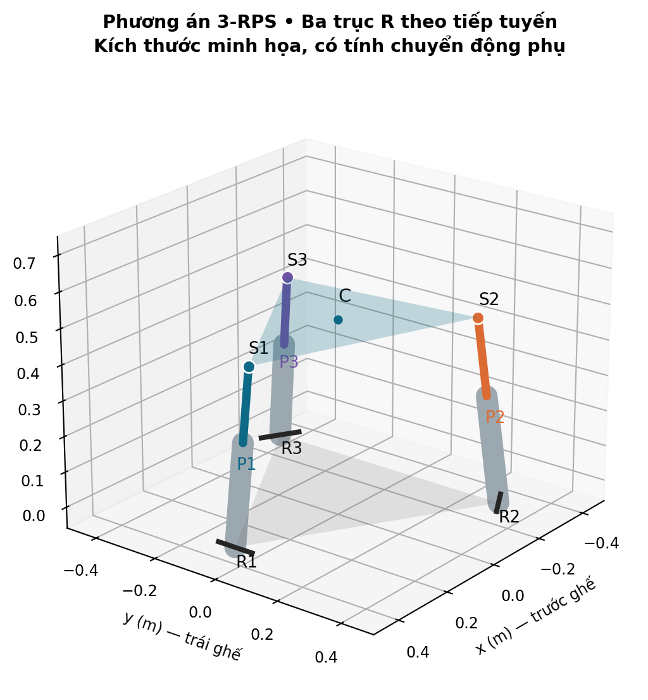
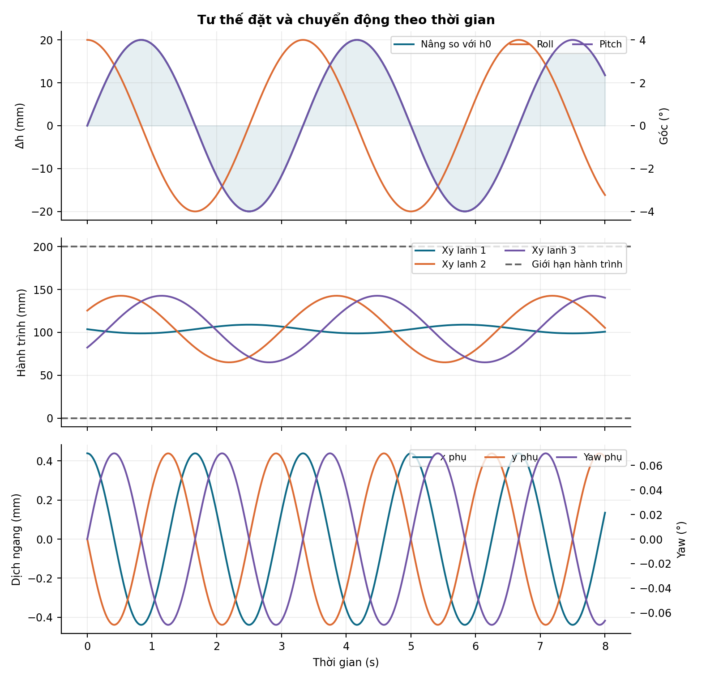
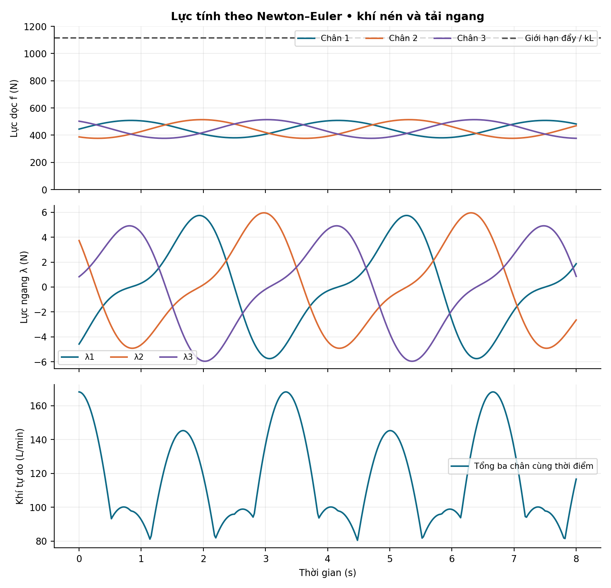

# 1. Kết quả bàn giao và phạm vi áp dụng

Bộ tài liệu gồm báo cáo Word này và chương trình MATLAB cho phép nhập trực tiếp tải trọng, hình học, thông số xy lanh và thông số vật liệu. Chương trình tính chiều dài/hành trình ba chân, vận tốc–gia tốc, động học thuận, lực dọc xy lanh, phản lực các khớp R, khả năng cấp lực khí nén và một số kiểm tra bền ban đầu. Có mô hình 3D, biểu đồ và các tệp kết quả để sử dụng trong thiết kế.

**Dữ liệu người dùng đã xác nhận:** ba xy lanh khí nén bố trí thành tam giác đều, đầu trên nối khớp cầu S, đầu dưới nối khớp xoay trục cố định R. Đây là cơ cấu dạng **3-RPS**: R — khớp quay, P — khớp trượt chủ động của xy lanh, S — khớp cầu. Kích thước được nhập trên MATLAB; người dùng cho phép chọn số liệu minh họa. Chưa có tải trọng, nhãn xy lanh, vật liệu hoặc bản vẽ khung thực tế.

**Giả thiết hình học còn cần xác nhận:** ba trục R nằm ngang, tiếp tuyến với đường tròn bố trí chân, tại các góc 0°, 120°, 240°. Hai tam giác cùng hướng ở tư thế trung tính. Đây là cách bố trí 3-RPS thông dụng và là phương án tính cụ thể được chọn trong báo cáo; kiểu khớp R–P–S do người dùng xác nhận chưa tự xác định hướng ba trục R. Nếu trục thực khác, phải thay véc tơ trục khớp và ràng buộc tương ứng.

**Đặc điểm cơ cấu 3-RPS:** mô hình gồm ba chân RPS theo mô tả người dùng. Chính ba khớp R tạo các ràng buộc mặt phẳng cho chân. Khi nghiêng, mặt ghế có thể dịch ngang và xuất hiện yaw phụ. Báo cáo và chương trình tính các chuyển động phụ này, không gán x = y = yaw = 0 ở mọi tư thế. Ba tọa độ độc lập được chọn là nâng h, roll φ và pitch θ; x, y và yaw ψ được xác định theo ràng buộc 3-RPS trên nhánh lắp gần tư thế trung tính.

Số liệu minh họa do người lập mô hình chọn, không phải số liệu đo của sản phẩm hoặc giá trị lấy nguyên từ bài báo. Cần xác nhận hướng trục khớp dưới và thay bằng thông số thực trước khi áp dụng cho chế tạo.

Phần tính bền là **sàng lọc thiết kế cơ khí**. Nó giúp phát hiện phương án không đủ lực, quá hành trình hoặc có ứng suất cao; chưa xác nhận toàn bộ sản phẩm đủ bền, đủ bền mỏi hay phù hợp đưa người lên vận hành. Những hạng mục chưa đủ dữ liệu được đánh dấu chưa đánh giá, không coi là đạt.

# 2. Đọc và sử dụng tám tài liệu tham khảo

Số trang trong bảng dưới là số trang PDF tính từ 1. Khi hữu ích, số trang in của ấn phẩm cũng được ghi để tra cứu. Các nội dung hướng dẫn phần mềm nằm trong PDF được xem là tư liệu, không phải yêu cầu thao tác của người dùng.

| Nguồn | Nội dung thực tế và phần được sử dụng | Giới hạn khi áp dụng |
|:---|:---|:---|
| [1] 5079-Bài báo…pdf | Võ Lâm Kim Thanh, Nguyễn Khôi Nguyên (2023), thiết bị dạy lái; PDF tr.1–3 và 7: bố trí người–ghế–vô lăng–màn hình | PDF tr.5, tr.61 in, nêu ghế không rung lắc. Không phải mô hình ba xy lanh và không có tính bền cho bệ chuyển động |
| [2] 10494.pdf | Chương điều khiển tay máy bằng thị giác; PDF tr.3: phân biệt động học thuận/ngược; tr.6–8: vòng ngoài/vòng khớp | Tay máy ASEA, không phải bệ ghế. Quy ước Euler của nguồn khác báo cáo này; không dùng công thức DH hoặc gain của tay máy cho ghế |
| [3] 13902.pdf | Nguồn phù hợp nhất: bệ khí nén 3DOF SIMPRO. PDF tr.4–6, (8), (9), (15), (16): ma trận quay, vòng véc tơ, hành trình và công ảo | Kiến trúc RPSU–2SPS có khâu phụ và dịch chuyển ngang khi nâng, PDF tr.3–5. Không chép nguyên hình học riêng hoặc coi yaw tự bằng 0 |
| [4] ame01_finalfullpaper.pdf | Bệ bay 3DOF; PDF tr.3–4: tọa độ tam giác đều, phép biến đổi quay–tịnh tiến | Dùng servo tay quay, không dùng xy lanh. Công thức góc servo arcsin ở PDF tr.4 không phải công thức hành trình piston. Tên roll/pitch khác quy ước báo cáo |
| [5] Dynamic…3-PRRU…pdf | Cơ cấu 1T2R không chuyển động phụ; nền tảng ràng buộc, Newton–Euler và phân tích hiệu năng động | “Không chuyển động phụ” là kết quả của cấu trúc khớp 3-PRRU cụ thể, không suy ra cho mọi bệ ba xy lanh |
| [6] IEEETVT_2008.pdf | Nehaoua và cộng sự (2008); PDF tr.4: gia tốc khối tâm lệch trục; tr.4–6: washout, phối hợp nghiêng | Bệ SIM2 nối tiếp, hai bậc tự do tịnh tiến dọc và quay ghế. Không phải hình học ba chân tam giác |
| [7] Parallel_Mechanisms_and_Robots.pdf | Merlet và Gosselin: động học, Jacobian, kỳ dị, miền làm việc, tĩnh học, động lực học của cơ cấu song song | Đây là cơ sở phương pháp; phải thay hình học và ràng buộc đúng sản phẩm |
| [8] Implementation…pdf | Nội dung thật: Rubio và cộng sự (2007), mô hình/nhận dạng/điều khiển xy lanh khí nén; PDF tr.3–6: khí nén, tr.9: bệ 2DOF | Tên tệp không trùng tên bài. Không phải bài CERMA 2009 có tên gần giống. Hàm truyền của hệ thử không áp trực tiếp cho xy lanh mới |

Cách kế thừa: dùng [3], [4], [7] để tự thiết lập hình học nhất quán; [3], [5], [7] cho phương pháp Jacobian–công ảo–Newton–Euler; [8] cho sự phụ thuộc lực và động đáp ứng vào áp suất, thể tích khí, van và ma sát; [6] cho sự khác biệt giữa chuyển động cơ khí và cảm giác gia tốc. [1], [2] hỗ trợ bối cảnh và nguyên tắc tổ chức điều khiển. Không nguồn nào trong bộ tám tài liệu đủ dữ liệu để chứng nhận bền toàn bộ thiết kế mới.

Một số biểu thức trong nguồn có lỗi in hoặc ký hiệu khó phân biệt. Ví dụ [3] PDF tr.13 có công thức hành trình dễ nhầm căn bậc hai, trong khi quan hệ rõ ràng ở (15), PDF tr.6, là chiều dài chân trừ chiều dài mốc. Chương trình dùng chuẩn Euclid của véc tơ và kiểm tra đơn vị, không sao chép biểu thức OCR.

# 3. Thông số đầu vào và quy ước

## 3.1. Hệ tọa độ, đại lượng và đơn vị

Hệ cố định Oxyz có x hướng về phía trước ghế, y về bên trái, z hướng lên; tuân theo quy tắc bàn tay phải. Hệ mặt động có gốc C ở tâm tam giác mặt động. Tọa độ tư thế:

$$
\mathbf q=[h,\ \phi,\ \theta]^T .
$$

h là chiều cao C so với mặt phẳng đế; φ là roll quanh x, θ là pitch quanh y theo quy ước Euler ZYX. Tư thế đầy đủ:

$$
R=R_z(\psi)R_y(\theta)R_x(\phi),\qquad \mathbf c=[x,y,h]^T.
$$

x, y và ψ không độc lập: chúng được suy ra từ ba ràng buộc khớp R ở mục 4. Mọi góc quay dùng quy tắc bàn tay phải; ở góc hữu hạn không hoán đổi thứ tự quay. Thành phần vận tốc góc theo z cũng không đơn giản bằng đạo hàm yaw Euler.

Trong lõi tính toán: m, kg, s, rad, N, Pa, N·m. Giao diện cho phép nhập góc theo độ và áp suất theo MPa rồi chuyển về SI. Tải người nhập theo kg, không nhập 900 N vào ô 90 kg. Áp suất dùng trong lực là áp suất dư so với môi trường; trong phương trình khí/lưu lượng là áp suất tuyệt đối.

## 3.2. Nhóm dữ liệu bắt buộc

| Nhóm | Đại lượng cần có | Cách xác định |
|:---|:---|:---|
| Hình học | Bán kính ngoại tiếp tam giác đế Rb, mặt động Rp; h0; hướng trục R | Đo tọa độ tâm khớp, không đo mép khung |
| Hành trình | Chiều dài tâm khớp thu hết Lmin; hành trình S; giới hạn góc quay R và lệch góc S | Catalog và đo lắp; Lmin khác chiều dài thân và khác hành trình |
| Tải | Khối lượng người, toàn bộ phần ghế chuyển động; tọa độ trọng tâm rG | Cân và xác định trọng tâm; gồm màn hình/vô lăng nếu cùng chuyển động |
| Quán tính | Ix, Iy, Iz tại trọng tâm trong hệ ghế | CAD hoặc thực nghiệm; ví dụ dùng tensor chéo, chỉ đúng nếu trục đã chọn là trục quán tính chính |
| Khí nén | D piston, d cần, áp nguồn tối thiểu, áp xả lớn nhất, hiệu suất, ma sát | Dùng áp tại cửa xy lanh khi chuyển động, không chỉ áp ghi trên máy nén |
| Cơ khí | E, giới hạn chảy từng vật liệu, chiều dài cần tự do, hệ số liên kết K, độ lệch tâm e | Theo vật liệu, điều kiện gá và catalog xy lanh |
| Chốt/khung | Đường kính chốt, số mặt cắt chịu cắt, chiều dày tai; tiết diện và nhịp dầm | Theo bản vẽ chế tạo |
| Chuyển động | Biên độ/tần số nâng và hai góc, thời gian và bước lấy mẫu | Theo mục tiêu mô phỏng và giới hạn phần cứng |

Chương trình hỗ trợ ba xy lanh giống nhau trong phiên bản bàn giao. Với xy lanh hoặc tọa độ lắp khác nhau giữa ba chân, phải mở rộng các tham số thành ba bộ riêng, không thay thế bằng thông số trung bình. Lực ngoài bổ sung và mômen ngoài trong mô hình đều được quy về trọng tâm G, biểu diễn theo hệ cố định. Mã cho phép thay góc bố trí cả hai tam giác và giải đóng vòng bằng số. Các công thức đóng x, y, ψ trong báo cáo được viết cho mặc định góc bằng 0 và cùng hướng; nếu dùng cấu hình lệch hướng hoặc trục R khác, cần kiểm lại mô hình ràng buộc.

## 3.3. Bộ số liệu minh họa

| Thông số | Giá trị mẫu | Ghi chú |
|:---|:---|:---|
| Khối lượng người / phần ghế chuyển động | 90 / 45 kg; tổng 135 kg | Có thể thay trực tiếp |
| Rb / Rp / h0 | 420 / 360 / 480 mm | Tam giác cùng hướng |
| Cạnh tam giác đế / mặt động | 727,46 / 623,54 mm | Bằng √3 lần bán kính |
| Lmin / hành trình S | 380 / 200 mm | Chiều dài tâm khớp, không phải chiều dài thân |
| D piston / d cần | 63 / 25 mm | Ba xy lanh giống nhau |
| Áp cấp dư / xả dư / khí quyển tuyệt đối | 0,60 / 0,05 / 0,101325 MPa | Áp cho phép mẫu 0,80 MPa phải thay bằng catalog |
| Hiệu suất lực η / ma sát Ff | 0,85 / 30 N | η không gồm khoản ma sát nhập riêng |
| Trọng tâm rG / quán tính tại G | (0; 0; 300) mm / diag(10;12;8) kg·m² | Bộ số liệu giả định |
| Quỹ đạo | nâng ±20 mm; roll/pitch ±4°; 0,30 Hz | Hai góc lệch pha 90°; 8 s, bước 0,02 s |
| Giới hạn tốc độ / góc chân | 0,20 m/s / 20° | Góc chân so với z đế và z mặt động |
| Hệ số tải kL / an toàn vật liệu n | 1,30 / 2 | Hai hệ số có vai trò khác nhau |
| Cần piston | E = 210 GPa; fy = 355 MPa; e = 0,5 mm | Đoạn cần tự do khi thu 80 mm; K = 1 |
| Ống xy lanh | thành dày 5 mm; fy = 250 MPa | Vật liệu mẫu; không suy ra áp định mức |
| Chốt và tai | chốt 16 mm; cắt kép; hai tai mỗi tai 8 mm | fy chốt/tai 355 MPa; chưa mô tả vòng chặn |
| Dầm ví dụ | hộp 60 × 80 × 4 mm; nhịp 800 mm | E = 210 GPa; fy = 235 MPa |

Các số liệu này dùng để kiểm tra thuật toán và hướng dẫn thao tác. Các đặc tính vật liệu, áp suất cho phép, góc khớp, tốc độ, chiều dài cần tự do, ma sát và quán tính phải được thay bằng dữ liệu thực. Không coi chúng là lựa chọn mua hàng đã được phê duyệt.

# 4. Thiết lập hình học tam giác đều

Đặt ba góc:

$$
\alpha_i=\frac{2\pi(i-1)}3,\quad i=1,2,3.
$$

Tọa độ tâm khớp dưới trong hệ đế và khớp trên trong hệ mặt động:

$$
\mathbf b_i=R_b[\cos\alpha_i,\ \sin\alpha_i,\ 0]^T,
\quad
\mathbf a_i=R_p[\cos\alpha_i,\ \sin\alpha_i,\ 0]^T.
$$

Rb và Rp là bán kính ngoại tiếp, không phải cạnh tam giác. Nếu biết cạnh ab và ap:

$$
R_b=\frac{a_b}{\sqrt3},\qquad R_p=\frac{a_p}{\sqrt3}.
$$

Vị trí khớp trên trong hệ cố định:

$$
\mathbf p_i=\mathbf c+R\mathbf a_i.
$$

Véc tơ chân, độ dài tâm khớp và hướng tác dụng lực:

$$
\mathbf d_i=\mathbf p_i-\mathbf b_i,\qquad
L_i=\sqrt{\mathbf d_i^T\mathbf d_i},\qquad
\mathbf u_i=\frac{\mathbf d_i}{L_i}.
$$

Ký hiệu a/b của báo cáo được định nghĩa ở đây, không nhất thiết trùng ký hiệu của từng bài tham khảo. Công thức véc tơ tương đương vòng kín trong [3], PDF tr.5, (9).

## 4.1. Ràng buộc do khớp xoay tại đế

Véc tơ đơn vị trục quay R của chân i được giả thiết:

$$
\mathbf t_i=[-\sin\alpha_i,\cos\alpha_i,0]^T.
$$

Chân chỉ quay trong mặt phẳng vuông góc với trục t_i, đi qua b_i. Vì vậy:

$$
g_i=\mathbf t_i^T(\mathbf c+R\mathbf a_i-\mathbf b_i)=0,\quad i=1,2,3.
$$

Giữ h, φ, θ cho trước, giải g = 0 để tìm x, y, ψ. Với tam giác cùng hướng và ba trục tiếp tuyến như trên, tổng ba phương trình cho $R_{21}=R_{12}$. Trên nhánh gần tư thế trung tính:

$$
\psi=\operatorname{atan2}
(\sin\theta\sin\phi,\ \cos\theta+\cos\phi),
$$

$$
x=\frac{R_p}{2}(R_{11}-R_{22}),\qquad
y=-R_pR_{21}.
$$

Chọn nhánh ψ gần 0; công thức này không liệt kê tất cả chế độ lắp xa tư thế trung tính. Nếu mẫu số/điều kiện đóng vòng mất hạng, phải loại tư thế và phân tích kỳ dị. Không dùng biểu thức trên cho các trục R tùy ý hoặc tam giác mặt động không theo giả thiết.

Ví dụ: chỉ pitch θ thì $x=R_p(\cos\theta-1)/2$; chỉ roll φ thì $x=R_p(1-\cos\phi)/2$. Khi đồng thời roll và pitch, yaw phụ thường khác 0, cỡ $\psi\simeq\phi\theta/2$ ở góc nhỏ. Các chuyển động phụ bậc hai này lý giải vì sao không thể gán mặt ghế chỉ quay hai góc và nâng hoàn toàn thẳng đứng.

{width=15cm}

# 5. Cách tính động học ngược

## 5.1. Công thức chính xác

Tính x, y, ψ theo mục 4.1 rồi lập R. Có thể lập các thành phần trung gian:

$$
X_i=\cos\theta x_i+\sin\theta\sin\phi y_i,\quad
Y_i=\cos\phi y_i,\quad
Z_i=-\sin\theta x_i+\cos\theta\sin\phi y_i.
$$

Với khớp trên $\mathbf a_i=[x_i,y_i,0]^T$:

$$
\begin{aligned}
d_{ix}&=x+\cos\psi X_i-\sin\psi Y_i-b_{ix},\\
d_{iy}&=y+\sin\psi X_i+\cos\psi Y_i-b_{iy},\\
d_{iz}&=h+Z_i,\\
L_i&=\sqrt{d_{ix}^2+d_{iy}^2+d_{iz}^2},\\
s_i&=L_i-L_{\min}.
\end{aligned}
$$

Cho h, φ, θ là tính được ba hành trình s1, s2, s3. Đây là động học ngược của bệ song song. Điều kiện hành trình:

$$
0\leq s_i\leq S.
$$

Không thay công thức độ dài bằng cao độ z của khớp khi xy lanh nghiêng. Đầu khớp trên dịch cả ngang lẫn đứng khi mặt động quay. Cũng không lấy s bằng h nếu Rb khác Rp hoặc có lệch góc lắp.

## 5.2. Gần đúng góc nhỏ để tính tay

Khi hai tam giác cùng hướng, φ, θ nhỏ và Rb = Rp:

$$
L_i\simeq h+y_i\phi-x_i\theta.
$$

Đặt đỉnh 1 trên +x:

$$
\begin{aligned}
L_1&\simeq h-R_p\theta,\\
L_2&\simeq h+\frac{\sqrt3R_p}{2}\phi+\frac{R_p}{2}\theta,\\
L_3&\simeq h-\frac{\sqrt3R_p}{2}\phi+\frac{R_p}{2}\theta.
\end{aligned}
$$

Góc tính bằng rad. Nếu Rb khác Rp, ở tư thế cân bằng có:

$$
L_0=\sqrt{h_0^2+(R_p-R_b)^2},\quad
\Delta L_i\simeq\frac{h_0}{L_0}
(\Delta h+y_i\Delta\phi-x_i\Delta\theta).
$$

Đây là khai triển tại trung tính, dùng kiểm tra sơ bộ dấu và độ lớn. Chương trình luôn tính công thức véc tơ chính xác.

# 6. Động học thuận, Jacobian và kỳ dị

## 6.1. Động học thuận

Khi biết hành trình đo của ba xy lanh, đổi về chiều dài:

$$
L_i^{meas}=L_{\min}+s_i^{meas}.
$$

Giải ba phương trình:

$$
\mathbf r(\mathbf q)=\mathbf L(\mathbf q)-\mathbf L^{meas}=\mathbf0.
$$

Newton có giảm bước:

$$
J(\mathbf q_k)\Delta\mathbf q=-\mathbf r(\mathbf q_k),
\quad
\mathbf q_{k+1}=\mathbf q_k+\gamma\Delta\mathbf q.
$$

Chọn 0 < γ ≤ 1 để sai số giảm. Dùng tư thế trước đó làm giá trị đầu nhằm theo đúng nhánh lắp. Bệ song song có thể có nhiều nghiệm; hội tụ số không chứng minh nghiệm đó là tư thế thật. Cần kiểm tra miền h/góc hợp lệ, trạng thái lắp, hoặc đối chiếu IMU/cảm biến nâng. Chương trình trả cờ hội tụ, không tự công nhận nghiệm khi sai số vẫn lớn.

## 6.2. Vận tốc và gia tốc

Đặt $R_\phi=dR/d\phi$, $R_\theta=dR/d\theta$ là **đạo hàm toàn phần**, gồm cả yaw phụ. Đồng thời $\mathbf c_\phi=d\mathbf c/d\phi$, $\mathbf c_\theta=d\mathbf c/d\theta$ gồm các dịch chuyển x,y phụ. Hàng i của Jacobian:

$$
J_{i,:}=
\left[
u_{iz},\
\mathbf u_i^T(\mathbf c_\phi+R_\phi\mathbf a_i),\
\mathbf u_i^T(\mathbf c_\theta+R_\theta\mathbf a_i)
\right].
$$

Không dùng Jacobian của mô hình x=y=yaw=0 cho 3-RPS. Các đạo hàm phụ có thể suy bằng đạo hàm hàm atan2 ở mục 4.1, hoặc vi phân ẩn ba ràng buộc $g(\boldsymbol\eta,\mathbf q)=0$, với $\boldsymbol\eta=[x,y,\psi]^T$:

$$
\frac{d\boldsymbol\eta}{d\mathbf q}
=-\left(\frac{\partial g}{\partial\boldsymbol\eta}\right)^{-1}
\frac{\partial g}{\partial\mathbf q}.
$$

Cần kiểm hạng cả Jacobian ràng buộc thụ động; J chủ động khả nghịch chưa tự xác nhận mọi loại kỳ dị của cơ cấu.

Quan hệ vận tốc và gia tốc:

$$
\dot{\mathbf L}=J\dot{\mathbf q},\qquad
\ddot{\mathbf L}=J\ddot{\mathbf q}+\dot J\dot{\mathbf q}.
$$

Bỏ $\dot J\dot{\mathbf q}$ sẽ làm sai gia tốc khi ghế đang quay. Chương trình tính J giải tích và đạo hàm J theo hướng chuyển động bằng sai phân trung tâm; vận tốc/gia tốc được kiểm tra độc lập bằng đạo hàm số chiều dài.

Hai cột góc của J có đơn vị m/rad, cột h không thứ nguyên. Vì vậy không so sánh trực tiếp số điều kiện của J theo các đơn vị tùy ý. Dùng tọa độ được chuẩn hóa $\bar{\mathbf q}=[h,R_p\phi,R_p\theta]^T$ và:

$$
\bar J=J\,\operatorname{diag}(1,1/R_p,1/R_p).
$$

Theo dõi hạng, giá trị kỳ dị nhỏ nhất và $\operatorname{cond}(\bar J)$. Ngưỡng số điều kiện trong chương trình là chỉ báo thiết kế do người dùng đặt, không phải giới hạn an toàn phổ quát. Gần kỳ dị, sai số cảm biến và lực có thể bị khuếch đại; phải giảm miền vận hành hoặc đổi hình học.

## 6.3. Miền làm việc

Kiểm tra đồng thời hành trình ba chân, góc chân so với trục z của đế và trục z của mặt động, tư thế và số điều kiện Jacobian. Giới hạn góc trong mã được đo từ phương z tại đế và phương z của mặt động, không phải độ lệch so với chân ở trung tính. Cần quy đổi nếu catalog cho giới hạn theo một phương gá khác. Với R, phải đồng thời kiểm phương trục và góc quay trong mặt phẳng chân.

Chương trình quét lưới trong hộp h–φ–θ đã khai báo. Tỷ lệ điểm hợp lệ là kết quả của lưới lấy mẫu; không chứng minh toàn bộ miền liên tục giữa các điểm hợp lệ. Giao thoa thân xy lanh, tai gá, ghế–đế, đường ống và điểm kẹp không được xác định bởi điều kiện chiều dài nên cần kiểm tra riêng bằng CAD và mô hình khớp thực.

# 7. Tính lực xy lanh và phản lực ràng buộc 3-RPS

## 7.1. Lực chủ động theo công ảo

Chia mg/3 chỉ đúng cho một số cấu hình đối xứng khi xét thành phần thẳng đứng. Góc chân, trọng tâm lệch và gia tốc làm tải phân bố không đều. Một chân có thể chịu kéo.

Gọi f_i là lực dọc chủ động, dương khi xy lanh đẩy mặt động theo u_i:

$$
\delta W=\mathbf f^T\delta\mathbf L
=\mathbf f^TJ\delta\mathbf q
=\mathbf Q^T\delta\mathbf q,\qquad
J^T\mathbf f=\mathbf Q.
$$

Khi J khả nghịch, giải hệ $J^T\mathbf f=\mathbf Q$ bằng phép giải hệ tuyến tính. Không tính nghịch đảo tường minh. Quan hệ này nhất quán với [3], PDF tr.6, (16), và phương pháp tĩnh/động lực học [7]. J ở đây là Jacobian **hiệu dụng của đúng 3-RPS**, đã tính chuyển động phụ.

## 7.2. Động lực học với chuyển động phụ

Gọi rG là véc tơ từ C tới trọng tâm trong hệ ghế:

$$
\mathbf c_G=\mathbf c+R\mathbf r_G,\quad
I_W=RI_GR^T,\quad
J_C=\frac{d\mathbf c}{d\mathbf q},\quad
J_G=J_C+\frac{d(R\mathbf r_G)}{d\mathbf q}.
$$

Với mỗi tọa độ qj, định nghĩa:

$$
[\mathbf E_{:,j}]_\times=\frac{dR}{dq_j}R^T,
\qquad
[\mathbf v]_\times\mathbf w=\mathbf v\times\mathbf w.
$$

Suy ra vận tốc/gia tốc góc và gia tốc trọng tâm:

$$
\boldsymbol\omega=E\dot{\mathbf q},\quad
\boldsymbol\alpha=E\ddot{\mathbf q}+\dot E\dot{\mathbf q},\quad
\mathbf a_G=J_G\ddot{\mathbf q}+\dot J_G\dot{\mathbf q}.
$$

Các đạo hàm theo thời gian bao gồm tác động của x, y và ψ. Chương trình tính đạo hàm theo hướng chuyển động, kiểm tra lại bằng sai phân vị trí. Không dùng ma trận E của mô hình yaw cố định vì yaw của 3-RPS thay đổi.

Lực ngoài Fext đặt tại G và ngẫu lực Mext được cho trong hệ cố định:

$$
\mathbf F_R=m\mathbf a_G+mg\mathbf e_z-\mathbf F_{ext},
$$

$$
\mathbf M_R=I_W\boldsymbol\alpha+
\boldsymbol\omega\times(I_W\boldsymbol\omega)-\mathbf M_{ext},
$$

$$
\mathbf Q=J_G^T\mathbf F_R+E^T\mathbf M_R.
$$

m gồm người và mọi phần cùng chuyển động. Mô hình hiện coi mặt ghế–người là một vật rắn và bỏ qua quán tính riêng từng thân/cần xy lanh. Nếu các chi tiết này nặng hoặc chuyển động nhanh, phải bổ sung vật rắn và lực quán tính tương ứng. Hệ số dự phòng không thay thế mô hình chi tiết khi thiếu hụt đó đáng kể.

## 7.3. Chân RPS còn truyền lực ngang và mômen chân đế

Khác thanh SPS lý tưởng chỉ chịu hai lực, chân RPS có ràng buộc mặt phẳng. Ngoài lực chủ động dọc u_i, chân có thể truyền phản lực thụ động λ_i t_i lên khớp cầu. Lực tổng ở S:

$$
\mathbf F_{S,i}=f_i\mathbf u_i+\lambda_i\mathbf t_i.
$$

Đặt $\mathbf r_i=R\mathbf a_i$ và:

$$
H_i=
\begin{bmatrix}\mathbf t_i\\\mathbf r_i\times\mathbf t_i\end{bmatrix},
\qquad
H=[H_1,H_2,H_3].
$$

Wrench còn lại sau lực dọc:

$$
\mathbf W_{res}=
\begin{bmatrix}\mathbf F_R\\\mathbf M_R+
(R\mathbf r_G)\times\mathbf F_R\end{bmatrix}
-\sum_i
\begin{bmatrix}f_i\mathbf u_i\\
\mathbf r_i\times(f_i\mathbf u_i)\end{bmatrix}.
$$

Giải $H\boldsymbol\lambda=\mathbf W_{res}$ bằng bình phương tối thiểu có chuẩn hóa hàng mômen theo chiều dài đặc trưng Rp. Trong mô hình lý tưởng đúng, nghiệm khớp cả sáu phương trình với sai số số học nhỏ; không chỉ lấy ba hàng rồi bỏ cân bằng còn lại.

Phản lực thụ động không sinh công trên chuyển động được phép:

$$
\begin{bmatrix}J_C\\E\end{bmatrix}^{T}H\simeq0.
$$

Kiểm cả dư cân bằng wrench và đẳng thức công ảo để phát hiện lỗi ràng buộc/lực. Do $\mathbf u_i\perp\mathbf t_i$:

$$
|\mathbf F_{S,i}|=\sqrt{f_i^2+\lambda_i^2},\qquad
|M_{R,i}|\simeq L_i|\lambda_i|.
$$

Mômen tại khớp R là đại lượng về độ lớn đối với mô hình chân bỏ qua trọng lượng; trục R tự do quay quanh t_i nhưng có thể truyền các thành phần mômen vuông góc trục đó. Không coi khớp quay là ngàm toàn phần hoặc là khớp cầu.

**Hệ quả cho xy lanh khí nén:** λ là tải ngang làm uốn cần/thân và gây tải lên bạc dẫn hướng. Xy lanh tiêu chuẩn có thể không cho phép tải ngang đáng kể. Phải kiểm catalog hoặc thiết kế dẫn hướng chịu tải trong từng chân theo cách không làm đổi ràng buộc. Chỉ đủ lực đẩy khí nén chưa đủ chọn được xy lanh.

## 7.4. Kiểm tra tính tay và lực thiết kế

Tại trung tính, trọng tâm trên trục giữa, đứng yên:

$$
L_0=\sqrt{h_0^2+(R_p-R_b)^2},\quad
f_1=f_2=f_3=\frac{mgL_0}{3h_0},\quad \lambda_i=0.
$$

Khi Rb=Rp, mỗi chân chịu mg/3. Đây là bài kiểm đối xứng, không áp cho toàn quỹ đạo. Tải nén/kéo thiết kế:

$$
P_{c,d}=k_L\max_{t,i}(f_i,0),\quad
P_{t,d}=k_L\max_{t,i}(-f_i,0).
$$

kL dự phòng sai số và tải chưa mô hình. Không nhân thêm một hệ số động trùng với gia tốc đã tính. Đối với chốt/tai, dùng $k_L\max|\mathbf F_{S,i}|$; với giá đỡ R dùng thêm mômen $k_LL_i|\lambda_i|$.

# 8. Chọn và kiểm tra xy lanh khí nén

## 8.1. Diện tích và lực khả dụng

$$
A_1=\frac{\pi D^2}{4},\qquad
A_2=\frac{\pi(D^2-d^2)}4.
$$

Dùng áp suất dư pS tại cửa cấp và pE tại cửa xả:

$$
F_{push}=\eta(p_SA_1-p_EA_2)-F_f,
$$

$$
F_{pull}=\eta(p_SA_2-p_EA_1)-F_f.
$$

Fpull là trị số khả năng kéo, không phải lực có dấu theo u_i. η là hệ số suy giảm lực hiệu dụng chưa bao gồm khoản ma sát Ff đã nhập; tránh nhập cùng một tổn thất hai lần. Khi tính chính xác từ áp hai buồng đo được, có thể đặt η = 1 và dùng mô hình ma sát xác định riêng.

Điều kiện kiểm lực:

$$
k_L\max(f_i,0)\leq F_{push},
\qquad
k_L\max(-f_i,0)\leq F_{pull}.
$$

Nếu một khả năng tính ra không dương thì nguồn áp/áp xả/ma sát không tạo được lực theo chiều đó. Không được hiển thị giá trị âm như sức kéo còn dư.

Áp nguồn tối thiểu suy theo yêu cầu lực nén tại một thời điểm:

$$
p_{S,req}=
\frac{(k_L f_i+F_f)/\eta+p_EA_2}{A_1}.
$$

Khi kéo, đổi A1 và A2 tương ứng. Đây là kiểm tra năng lực lực tĩnh/tức thời theo áp giả thiết, chưa chứng minh van và máy nén giữ được áp đó suốt chuyển động.

## 8.2. Tốc độ và lưu lượng

Kiểm $|\dot L_i|\leq v_{max}$. Lưu lượng thể tích cấp tại buồng xy lanh ước lượng:

$$
Q_{i,ch}\simeq
A_1\max(\dot L_i,0)+A_2\max(-\dot L_i,0).
$$

Lưu lượng quy đổi về không khí tự do, khi nhiệt độ cấp và quy chiếu xấp xỉ nhau:

$$
Q_{i,free}\simeq
\frac{p_{S,g}+p_{atm}}{p_{atm}}Q_{i,ch}.
$$

Đổi m³/s sang L/min bằng hệ số 60 000. Cộng ba chân tại cùng thời điểm rồi lấy cực đại; không mặc định tổng bằng ba lần một giá trị trung bình. Giá trị này chưa gồm nén thể tích chết, ống, rò rỉ, quá độ nạp, tổn thất van và chu kỳ công tác. Định nghĩa “NL/min” trong catalog có thể dùng nhiệt độ/áp suất quy chiếu khác, phải đổi thống nhất trước khi so sánh.

Van tỷ lệ/servo và bình tích khí cần được chọn theo đường đặc tính lưu lượng theo chênh áp; một con số lưu lượng danh định đơn lẻ không đủ dự đoán băng thông.

## 8.3. Vì sao chưa thể mô phỏng kín khí nén chỉ với D, S và p?

Thể tích hai buồng, có thể tích chết V10, V20:

$$
V_1=V_{10}+A_1s,\qquad V_2=V_{20}+A_2(S-s).
$$

Dạng khí lý tưởng đẳng nhiệt:

$$
\dot p_1=\frac{RT}{V_1}\dot m_1
-\frac{p_1A_1}{V_1}\dot s,\qquad
\dot p_2=\frac{RT}{V_2}\dot m_2
+\frac{p_2A_2}{V_2}\dot s.
$$

Ở đây p1, p2 là **áp suất tuyệt đối**, $\dot m$ là lưu lượng khối lượng vào ròng mỗi buồng. Để tích phân cần thêm đặc tính van, áp môi trường, nhiệt độ, thể tích ống/chết, rò rỉ và ma sát. Không dùng áp suất dư trong tỉ số áp suất qua van.

Theo [8], PDF tr.3–6, động lực học thay đổi theo vị trí piston và thông số van; cần nhận dạng hoặc dữ liệu catalog. Vì người dùng chưa cung cấp chúng, chương trình bàn giao là mô hình động học + lực yêu cầu + năng lực khí nén sơ bộ, **không phải mô phỏng xác nhận bộ điều khiển van hay đáp ứng áp suất**. Không có PID chung được tính sẵn cho phần cứng chưa xác định.

# 9. Cách tính độ bền

Các công thức trong mục này là cơ học vật rắn/sức bền vật liệu cơ bản, bổ sung để phục vụ thiết kế; không gán chúng là kết quả kiểm bền của tám bài tham khảo. Cần xác định tải, điều kiện biên và vật liệu thật trước khi kết luận.

## 9.1. Cần piston: kéo/nén và uốn do lệch tâm

Với cần tròn đặc đường kính d:

$$
A_r=\frac{\pi d^2}{4},\quad
I_r=\frac{\pi d^4}{64},\quad
W_r=\frac{\pi d^3}{32}.
$$

Nếu đường lực lệch tâm e và tải ngang λ tác dụng lên đoạn cần tự do, mô hình sàng lọc đoạn cần như dầm công xôn cho:

$$
M_d\simeq |P_d|e+k_L|\lambda_i|L_e,\qquad
\sigma_{max}\simeq\frac{|P_d|}{A_r}+\frac{|M_d|}{W_r}.
$$

Điều kiện đàn hồi sơ bộ $\sigma_{max}\leq f_{y,r}/n$. Mô hình công xôn của đoạn cần là một giả thiết sàng lọc sơ bộ, không mô tả đầy đủ khoảng cách hai bạc dẫn và chia tải giữa thân/cần. Đây là ứng suất danh nghĩa bậc một; chưa kể tập trung ứng suất ở ren/rãnh, xước/mạ, phân bố tải ngang trong bạc/thân, uốn bậc hai hoặc mỏi. Không đặt tải ngang bằng 0 cho chân RPS. Ưu tiên giới hạn tải ngang và biểu đồ lắp đặt của nhà sản xuất; nếu không có dữ liệu này thì hạng mục tải ngang xy lanh vẫn chưa được xác nhận, dù ứng suất danh nghĩa nhỏ.

## 9.2. Mất ổn định cần piston

Chiều dài tính toán là đoạn cần tự do chịu nén, không nhất thiết bằng chiều dài tâm khớp toàn xy lanh:

$$
L_e=L_{free,0}+s,\quad
i_r=\sqrt{I_r/A_r},\quad
\lambda=\frac{K L_e}{i_r}.
$$

Euler đàn hồi:

$$
P_{cr}=\frac{\pi^2E_rI_r}{(KL_e)^2},\qquad
P_{c,d}\leq\frac{P_{cr}}n.
$$

K = 1 cho mô hình hai đầu khớp lý tưởng; các trị số 0,5; khoảng 0,7; 2 tương ứng các điều kiện biên lý tưởng khác, chỉ dùng khi cách gá thực phù hợp. Gối dẫn trong thân xy lanh làm điều kiện biên phức tạp; ưu tiên biểu đồ tải–hành trình và hệ số lắp của nhà sản xuất.

Cần kiểm tra miền áp dụng Euler. Mốc sàng lọc đơn giản:

$$
\lambda_{yield}=\pi\sqrt{\frac{E_r}{f_{y,r}}}.
$$

Nếu λ nhỏ hơn mốc này thì Euler dự đoán ứng suất mất ổn định vượt chảy; không được coi kết quả Euler là sức chịu tải hợp lệ. Ngay cả lớn hơn mốc, cần kiểm theo giới hạn tỷ lệ thực của vật liệu hoặc catalog. Trong miền trung gian phải dùng đường cong ổn định không đàn hồi/tiêu chuẩn hoặc dữ liệu nhà sản xuất; chương trình ghi **CHƯA ĐÁNH GIÁ trong miền Euler không phù hợp**.

Kiểm P/Pcr lớn cũng cảnh báo cần phân tích độ võng ban đầu và hiệu ứng bậc hai. Một phép so sánh Euler và ứng suất dọc riêng lẻ không thay thế phân tích cột lệch tâm có độ võng lớn.

## 9.3. Ống xy lanh chịu áp

Gọi ri = D/2, ro = ri + t, p là áp dư trong buồng, ngoài ống ở áp môi trường. Với ống trụ dày, nghiệm Lamé tại mặt trong:

$$
\sigma_\theta=p\frac{r_o^2+r_i^2}{r_o^2-r_i^2},
\quad
\sigma_r=-p,\quad
\sigma_z=p\frac{r_i^2}{r_o^2-r_i^2}.
$$

Biểu thức σz giả thiết ống kín hai đầu truyền lực áp suất theo mô hình thành ống. Thiết kế thanh giằng, nắp ren, nắp ép hoặc kết cấu khác phải kiểm tải theo đường truyền thật.

$$
\sigma_{VM}=
\sqrt{\frac{
(\sigma_\theta-\sigma_r)^2+
(\sigma_r-\sigma_z)^2+
(\sigma_z-\sigma_\theta)^2}{2}}
\leq\frac{f_{y,tube}}n.
$$

Chọn áp kiểm là áp lớn nhất hệ thống có thể đạt, bao gồm ngưỡng van an toàn và quá độ nếu đã biết, không chỉ áp làm việc trung bình. Với thành mỏng có thể kiểm đối chiếu $\sigma_\theta\simeq pD/(2t)$, nhưng Lamé phù hợp hơn khi t/D không nhỏ.

Đối với xy lanh thương mại, nhãn áp suất cho phép, thử kín và tải lệch của nhà sản xuất quan trọng hơn phép tự suy từ vật liệu giả định. Công thức chưa kiểm nắp, bulông, thanh giằng, ren, phớt hay mỏi áp suất. Áp dư nhập là đại lượng lực, tuyệt đối không tự tăng áp nguồn vượt định mức để bù một xy lanh thiếu lực.

## 9.4. Chốt và tai liên kết

Với chốt đường kính dp, Ns mặt cắt chịu cắt, dùng Pd là lực tổng tại khớp, gồm cả thành phần thụ động λ:

$$
\tau=\frac{P_d}{N_s\pi d_p^2/4}.
$$

Mô hình tai giữa có tổng bề dày chịu ép được nhập là tb:

$$
\sigma_b=\frac{P_d}{d_p t_b}.
$$

Tại khớp R đáy, thành phần λ theo trục quay là tải dọc chốt, không phải tải cắt chốt. Phải kiểm lực dọc trục, vai chốt, vòng chặn hoặc cơ cấu giữ chốt riêng; dùng lực tổng trong phép kiểm cắt mẫu không thay các kiểm tra này.

Nếu chốt thép dẻo dùng von Mises, điều kiện cắt thuần sơ bộ $\tau\leq f_{y,pin}/(\sqrt3n)$. Khả năng ép mặt dùng vật liệu tai và ứng suất cho phép tương ứng. Không mặc định “cắt kép” nếu sơ đồ gá thật là công xôn một tai.

Phải kiểm thêm uốn chốt do khe hở giữa tai, xé mép và tiết diện thuần của tai:

$$
\sigma_{net}=\frac{P_d}{(b-d_h)t},\qquad
\tau_{tear}\simeq\frac{P_d}{2(e_{edge}-d_h/2)t}.
$$

Các đại lượng b, dh, eedge phải lấy từ bản vẽ. Chương trình chỉ tự động kiểm phần chốt/ép mặt có đủ đầu vào; xé mép, uốn chốt và tiết diện thuần được ghi là hạng mục bổ sung.

## 9.5. Khung: mô hình dầm và kiểm toàn hệ

Ví dụ một dầm hộp chữ nhật rộng B, cao H, dày t:

$$
I_x=\frac{BH^3-(B-2t)(H-2t)^3}{12},\qquad
W_x=\frac{2I_x}{H}.
$$

Với một dầm kê hai đầu nhịp l chịu một lực tập trung F ở giữa:

$$
M_{max}=\frac{Fl}{4},\qquad
\sigma_b=\frac{M_{max}}{W_x},\qquad
\delta_{max}=\frac{Fl^3}{48EI_x}.
$$

Chương trình dùng tải thẳng đứng tương đương có hệ số dự phòng làm ví dụ sàng lọc. Đây không phải mô hình đầy đủ của khung ba điểm; không tự phân chia một phần ba tải cho mọi thanh. Đổi liên kết sang công xôn hoặc đặt lực lệch tâm thì công thức thay đổi.

Mô hình phần tử hữu hạn cần dùng tọa độ bản mã và các lực tổng ở các chân và mômen giá đỡ R ở những tư thế bất lợi; xem cả uốn hai phương, xoắn, ổn định cục bộ, độ cứng ảnh hưởng cảm giác/độ chính xác, chuyển vị, mối hàn và bulông. Kiểm neo đế với phản lực sàn, trượt/lật và tải người lên/xuống ghế. Các hạng mục này chưa được chương trình đơn giản tự xác nhận.

## 9.6. Mỏi, tuổi thọ và tải bất thường

Một ghế mô phỏng làm việc theo chu kỳ cần kiểm mỏi, không chỉ chảy tĩnh. Với mẫu chu kỳ đơn giản:

$$
\sigma_a=(\sigma_{max}-\sigma_{min})/2,\qquad
\sigma_m=(\sigma_{max}+\sigma_{min})/2.
$$

Quan hệ Goodman sàng lọc cho vật liệu và điều kiện thích hợp:

$$
\frac{\sigma_a}{S_e}+\frac{\sigma_m}{S_{ut}}\leq\frac1{n_f}.
$$

Với phổ nhiều mức có thể đếm chu kỳ và dùng quy tắc Miner $\sum n_j/N_j\leq1$ theo giả thiết và tiêu chuẩn chọn. Không lấy Se bằng giới hạn chảy; mối hàn cần đường cong mỏi theo chi tiết hàn, không áp Goodman vật liệu nền tùy tiện.

Chưa có lịch sử tải, số giờ vận hành, dữ liệu S–N, đặc điểm hàn và tập trung ứng suất nên chưa tính tuổi thọ mỏi. Phải bổ sung trường hợp người lệch ghế, dừng khẩn, kẹt chân, mất áp hoặc van lỗi theo kiến trúc thực tế. Cơ cấu giữ tải/chống rơi cần chọn theo đường tải; khí bị nén không tự tạo cơ cấu khóa cơ khí ổn định.

# 10. Cách sử dụng MATLAB

## 10.1. Chạy và nhập thông số

Giải nén thư mục MATLAB_Ghe3XyLanh, mở MATLAB và chuyển Current Folder tới thư mục này. Chương trình không cần Robotics Toolbox, Optimization Toolbox hay Simulink.

~~~matlab
p = ghe3_defaults();
r = run_ghe3(true, p, fullfile(pwd,'ket_qua'));
~~~

Các cửa sổ nhập cho phép thay tải người, khối lượng phần ghế, hình học, áp suất, kích thước xy lanh, thông số vật liệu và chuyển động. Khi không có giao diện đồ họa, dùng nhập ở cửa sổ lệnh hoặc thay trường trong cấu trúc p như ví dụ trong README. Gọi không đối thoại:

~~~matlab
p = ghe3_defaults();
% Tra ten truong va don vi trong README.md / ghe3_defaults.m
r = run_ghe3(false, p, fullfile(pwd,'ket_qua'));
test_ghe3;
~~~

Chương trình xuất kết quả số trước khi vẽ. Đồ thị 3D, hành trình, lực và các biểu đồ bổ sung chỉ hiển thị khi bật chế độ đồ họa phù hợp. Các tệp CSV dùng SI và nêu đơn vị ở tên cột; tệp MAT lưu tham số và kết quả để tái kiểm tra.

## 10.2. Các bước tính trong mã

1. Kiểm tra thông số có giá trị hữu hạn, đường kính cần nhỏ hơn piston, chiều dày/nhịp/hành trình hợp lệ và áp suất có nghĩa.
2. Lập tọa độ ba chân, tư thế trung tính và quỹ đạo sin tham chiếu.
3. Tính chuyển động phụ x, y, ψ và kiểm ràng buộc; tính L, s, J, vận tốc và gia tốc chân theo từng thời điểm.
4. Tính lực với Newton–Euler/công ảo; xuất lực ngang thụ động và mômen giá đỡ R.
5. So sánh hành trình, góc khớp, số điều kiện, tốc độ, lực đẩy/kéo; ước lượng lưu lượng.
6. Quét lưới hình học và thực hiện kiểm bền sơ bộ có trạng thái đạt/không đạt/chưa đánh giá.
7. Lưu cấu hình, CSV, MAT, kết quả kiểm thử và biểu đồ.

Quỹ đạo ví dụ là tín hiệu giải tích phục vụ phân tích ngoại tuyến. Điểm đầu có thể có vận tốc khác 0; **không xuất thẳng thành lệnh van khi đang đứng yên**. Khi điều khiển thật phải nối từ trạng thái đo bằng đoạn chuyển tiếp trơn, giới hạn vận tốc/gia tốc/jerk và xử lý khi một chân chạm giới hạn.

## 10.3. Từ cảm giác lái sang tư thế ghế

Chuỗi đề xuất:

~~~text
Gia tốc xe / trang thai game
  -> motion cueing, washout va gioi han
  -> h, roll, pitch mong muon
  -> dong hoc nguoc
  -> hanh trinh ba xy lanh
  -> vong vi tri xy lanh / van ti le
  -> phan hoi cam bien hanh trinh, ap suat va IMU
~~~

Bệ 3-RPS có ba tọa độ điều khiển nhún và hai góc nghiêng; x/y/yaw là chuyển động phụ theo ràng buộc, không điều khiển độc lập. Phối hợp nghiêng dùng thành phần trọng lực để tái tạo một phần cảm giác gia tốc; không đồng nghĩa ghế tái tạo đầy đủ động lực học xe. [6] cung cấp cơ sở motion cueing; [3], [8] chỉ ra yêu cầu phản hồi/nhận dạng. Phiên bản bàn giao tập trung vào phân tích cơ khí; chưa tích hợp telemetry game hoặc phát lệnh phần cứng.

# 11. Ví dụ tính và kết quả kiểm chứng

Kịch bản: tổng khối lượng 135 kg, tư thế trung tính h0 = 480 mm; tam giác đế và mặt động có bán kính 420 mm và 360 mm. Quỹ đạo sử dụng nâng sin, roll cos và pitch sin, cùng tần số 0,30 Hz. Đây là một quỹ đạo kiểm toán ngoại tuyến.

Tính tay tại trung tính: L0 = 483.735 mm; cosβ = 0.992278; mỗi lực dọc f = 444.89 N. Kết quả chương trình khớp quan hệ này, thay vì chia 1324,35 N thành ba lực dọc bằng nhau khi chân nghiêng.

| Đại lượng | Kết quả mẫu | Diễn giải |
|:---|:---|:---|
| Chiều dài tâm khớp ba chân | 445.055 đến 522.709 mm | Phụ thuộc tư thế |
| Hành trình piston | 65.055 đến 142.709 mm | Trong khoảng nhập 0–200 mm |
| Vận tốc chân lớn nhất | 0.07360 m/s | Dưới giới hạn mẫu 0,20 m/s |
| Gia tốc chân lớn nhất theo trị tuyệt đối | 0.13878 m/s² | Đã có Jdot qdot |
| Lực dọc f theo quỹ đạo | 376.93 đến 514.24 N | Quỹ đạo mẫu chưa có chân chịu kéo |
| Lực nén thiết kế lớn nhất, kL = 1,30 | 668.51 N | So sánh với năng lực đẩy |
| Khả năng đẩy / kéo giả thiết | 1448.17 / 1176.97 N | Theo áp, η và ma sát đã nhập |
| Áp nguồn dư yêu cầu ở tải nén thiết kế lớn nhất | 0.3057 MPa | Chỉ là cân bằng lực theo giả thiết |
| Khí tự do lớn nhất, cộng cùng thời điểm | 168.11 L/min | Cùng nhiệt độ quy chiếu; chưa gồm quá độ và rò |
| Lực ngang thụ động lớn nhất tại một chân | 5.950 N | Cần kiểm tải ngang xy lanh theo hãng |
| Mômen chân đế lớn nhất | 2.864 N·m | Trước hệ số tải; chưa cộng tự trọng chân |
| Dịch ngang phụ lớn nhất theo thành phần | 0.4385 mm | Không bị gán bằng 0 |
| Yaw phụ lớn nhất | 0.06984° | Phụ thuộc đồng thời roll–pitch |
| Số điều kiện Jacobian chủ động chuẩn hóa lớn nhất | 1.43339 | Không thay thế kiểm kỳ dị ràng buộc |
| Lưới hình học hợp lệ | 729/729 điểm | Lưới 9 × 9 × 9; không chứng minh miền liên tục |
| Ứng suất cần danh nghĩa lớn nhất | 2.2090 MPa | Đã cộng uốn bậc một do λ và lệch tâm |
| Oằn Euler | CHƯA ĐÁNH GIÁ | λ lớn nhất 35.63 < mốc 76.41; cần mô hình/catalog phù hợp |
| Ứng suất VM thành ống | 4.0721 MPa | Chỉ tại áp nguồn mẫu 0,60 MPa |
| Kiểm cắt chốt / ép mặt danh nghĩa | 1.6625 / 2.6114 MPa | Không thay kiểm dọc chốt R và giữ chốt |
| Uốn dầm ví dụ / độ võng giữa nhịp | 14.7179 MPa / 0.0934 mm | Chưa kết luận khung thật đủ bền |

Kết quả ứng suất nhỏ so với mức cho phép giả định chỉ là kết quả của các mô hình đã khai báo. **Không có kết luận “toàn ghế đạt bền”.** Các mục chưa đánh giá gồm ổn định cần theo dữ liệu phù hợp, tải ngang/bạc dẫn hướng xy lanh, mỏi, nắp–ren–mối hàn, cơ cấu giữ chốt và khung/neo toàn hệ.

{width=15cm}

{width=15cm}

## 11.1. Các phép kiểm có ý nghĩa

Đã thực thi mã .m bằng **GNU Octave 9.4.0** ở chế độ không đồ họa. Môi trường kiểm tra hiện không cài MATLAB; vì vậy đây là kiểm chứng mã số tương thích MATLAB bằng Octave, không phải bằng chứng đã mở/chạy các cửa sổ MATLAB hoặc vẽ đồ họa MATLAB. Các hình trong báo cáo được dựng từ CSV/MAT đã xuất bằng công cụ vẽ khoa học.

**12 nhóm kiểm tra đã chạy và đạt**, gồm:

1. Jacobian giải tích/vi phân ẩn đối chiếu sai phân độc lập chiều dài.
2. 200 tư thế ngẫu nhiên kiểm động học ngược → thuận trên nhánh lắp gần trung tính.
3. Cân bằng tải tĩnh đối xứng có xét góc chân.
4. Tải tĩnh với trọng tâm lệch x, y.
5. Công suất lực chủ động, ba điều kiện mặt phẳng R, công ảo phản lực thụ động và cân bằng không gian; so chuyển động phụ với nghiệm đóng độc lập.
6. Lực suy rộng Newton–Euler đối chiếu tính Lagrange từ động năng/thế năng bằng cách cài đặt độc lập.
7. Đạo hàm tư thế và chiều dài chân đối chiếu sai phân thời gian.
8. Bao tải nén/kéo, phân biệt miền Euler; hạ áp để kiểm khả năng phát hiện thiếu lực.
9. Ứng suất Lamé đối chiếu một dạng đẳng thức von Mises độc lập.
10. Chặn các đầu vào không hợp lệ, như d cần ≥ D piston, hệ số an toàn < 1 hoặc tensor quán tính không thể có.
11. Chạy toàn bộ quỹ đạo, FK, các giới hạn hình học/tốc độ và quy đổi/cộng lưu lượng theo cùng thời điểm.
12. Đối chiếu một bộ lực dọc và phản lực ngang với mô hình Python độc lập; kiểm khối lượng người bằng 0 cho bước kiểm không có người.

Ở quỹ đạo mẫu, sai số đóng vòng mặt phẳng lớn nhất khoảng 7.59e-13 m; sai số FK chuẩn hóa lớn nhất 1.21e-14 m; dư cân bằng lực/mômen lớn nhất theo các thành phần SI 1.64e-13; dư công ảo ràng buộc 7.33e-17. Đã kiểm thêm bộ nhập ở console: nhập tải người 75 kg và giữ phần ghế 45 kg cho tổng 120 kg đúng như yêu cầu. Các con số sai số trên chứng minh tính nhất quán số học trong mô hình lý tưởng, không biểu diễn độ chính xác chế tạo hoặc độ chính xác cảm biến.

Các phép kiểm trên xác nhận tính nhất quán của thuật toán với mô hình đã nêu. Chúng không xác nhận sơ đồ khớp thực tế của người dùng, độ chính xác catalog hay độ bền của sản phẩm chế tạo. Hướng trục R tiếp tuyến vẫn là giả thiết cần đối chiếu với bản vẽ thực.

## 11.2. Cách đọc kết quả không đạt và chưa đánh giá

- Không đạt hành trình: đổi h0, kích thước/hành trình hoặc giảm miền chuyển động rồi tính lại; không cắt lệnh riêng từng chân vì làm đổi tư thế.
- Không đủ lực: kiểm áp tại cửa, áp xả, tải và góc chân; chọn xy lanh/van phù hợp thay vì vượt áp cho phép.
- Vượt tốc độ/lưu lượng: giảm biên độ/tần số, đổi hình học, chọn van/ống/nguồn khí phù hợp và kiểm động lực học áp.
- Không đạt ứng suất: sửa tiết diện/đường tải/độ lệch tâm hoặc chọn vật liệu đúng; phải tính lại cả liên kết.
- Chưa đánh giá oằn: cung cấp giới hạn theo catalog hoặc mô hình ổn định phù hợp, không đổi trạng thái sang đạt chỉ vì Euler cho số lớn.
- Kỳ dị hoặc FK không hội tụ: kiểm nhánh lắp, tính đủ ràng buộc, giá trị đầu và miền vận hành. Không dùng một nghiệm không kiểm chứng để điều khiển ghế.

# 12. Dữ liệu cần bổ sung cho chính sản phẩm

Kiểu khớp đã rõ ở mức R–P–S. Điểm cần xác nhận tiếp là **hướng ba trục quay R** có đúng nằm ngang và tiếp tuyến như mô hình hay không, và có thêm thanh/ràng buộc nào chưa thể hiện hay không. Nếu khác, cần lập lại điều kiện mặt phẳng của từng chân và giải chuyển động phụ thực tế.

Cần thay số liệu minh họa bằng: tọa độ tâm khớp; khối lượng và trọng tâm ghế–người–thiết bị; tensor quán tính; mã xy lanh và giới hạn tải ngang; van, áp suất động và định mức; chiều dài cần tự do; vật liệu và bản vẽ chốt/tai/khung/mối hàn/neo; biên độ, tần số và tuổi thọ yêu cầu. Kích thước được nhập trực tiếp trên MATLAB theo các ô/biến có đơn vị rõ ràng.

Lộ trình xác minh phù hợp: kiểm mô hình số → lắp không tải → tải giả theo mức → đo áp, hành trình, IMU và biến dạng/độ võng ở điều kiện kiểm soát → đối chiếu lực và giới hạn. Đặc biệt đo/ước lượng tải ngang và mômen chân đế vì ba chân RPS không chỉ truyền lực dọc xy lanh.

# Phụ lục A. Khi ràng buộc thực khác mô hình tham chiếu

Với tư thế tổng quát $\mathbf x=[x,y,z,\phi,\theta,\psi]^T$, luôn có:

$$
L_i(\mathbf x)=\|\mathbf c(\mathbf x)+R(\mathbf x)\mathbf a_i-\mathbf b_i\|.
$$

Ba chiều dài chỉ cung cấp ba ràng buộc vô hướng. Để xác định sáu biến tư thế cần thêm tập ràng buộc độc lập $\boldsymbol\Phi(\mathbf x,\boldsymbol\eta)=0$ do loại khớp/khâu thụ động, với η là biến khớp thụ động nếu có. Phải đếm hạng Jacobian ràng buộc tại các tư thế làm việc, không chỉ áp dụng công thức đếm khớp hình thức.

Khi giải được chuyển động phụ theo ba tọa độ độc lập $\mathbf x=\mathbf x(\mathbf q)$:

$$
J_{eff}=\frac{\partial\mathbf L}{\partial\mathbf x}
\frac{\partial\mathbf x}{\partial\mathbf q}.
$$

Sử dụng Jeff trong quan hệ vận tốc và công ảo; cập nhật JG, E và tải ràng buộc khớp R theo chính cơ cấu. Các hàm hình học/động lực học trong bộ mã được tách riêng để hỗ trợ bước thay mô hình này. Không sửa đơn lẻ Rb/Rp để giả lập một ràng buộc khớp khác.

# Phụ lục B. Bảng kiểm tính toán bằng tay

| Bước | Công thức/đầu ra | Đơn vị |
|:---|:---|:---|
| 1 | m = mngười + mchuyển động | kg |
| 2 | Rb = ab/√3; Rp = ap/√3 | m |
| 3 | pi = c + Rai; di = pi − bi | m |
| 4 | Li = norm(di); si = Li − Lmin | m |
| 5 | J; Ldot = J qdot; Lddot = J qddot + Jdot qdot | m/s, m/s² |
| 6 | aG, ω, α; Q; giải Jᵀ f = Q | N, N·m |
| 7 | Lực ngang λ, mômen chân R; kiểm công ảo | N, N·m |
| 8 | Fpush, Fpull; lực thiết kế theo kL | N |
| 9 | σ cần; λ, Pcr và miền Euler | MPa, không thứ nguyên, N |
| 10 | Ứng suất ống Lamé, chốt/ép mặt, dầm mẫu | MPa, mm |
| 11 | Hạng mục chưa đánh giá: mỏi, ren, mối hàn, neo, va chạm | Ghi rõ dữ liệu thiếu |

# Tài liệu tham khảo

[1] Võ Lâm Kim Thanh và Nguyễn Khôi Nguyên (2023). “Nghiên cứu chế tạo mô hình dạy lái ô tô”. Tạp chí Khoa học Đại học Cần Thơ, 59(4A), 57–65. DOI: 10.22144/ctujos.2023.161. Tệp: 5079-Bài báo-14708-3-10-20230831.pdf.

[2] Luis Hernández, Hichem Sahli và René González (2010). “Vision-based 2D and 3D Control of Robot Manipulators”. Chương 20, Robot Manipulators, Trends and Development, 441–462. Tệp: 10494.pdf.

[3] Luis Hernández, Eduardo Izaguirre, Ernesto Rubio, Orlando Urquijo và Jorge Guerra. “Kinematic Task Space Control Scheme for 3DOF Pneumatic Parallel Robot”. Chương 5, Object Tracking, 67–84; PDF tạo năm 2011. Tệp: 13902.pdf. Năm theo metadata/chương được cung cấp; không bổ sung DOI chưa xác minh.

[4] อภิลักษณ์ หล่อนกลาง và ชโลธร ธรรมแท้ (2015). “A Development of 3-DOF Flight Simulator”. ME-NET 2015, 29th Conference of Mechanical Engineering Network of Thailand, AME-01, 214–219. Tệp: ame01_finalfullpaper.pdf.

[5] Genliang Chen, Weidong Yu, Qinchuan Li và Hao Wang (2017). “Dynamic modeling and performance analysis of the 3-PRRU 1T2R parallel manipulator without parasitic motion”. Nonlinear Dynamics. DOI: 10.1007/s11071-017-3665-0. Tệp: Dynamicmodelingandperformanceanalysisofthe3-PRRU1T2Rparallelmanipulatorwithoutparasiticmotion.pdf.

[6] Lamri Nehaoua, Hakim Mohellebi, Ali Amouri, Hichem Arioui, Stéphane Espié và Abderrahmane Kheddar (2008). “Design and Control of a Small-Clearance Driving Simulator”. IEEE Transactions on Vehicular Technology, 57(2), 736–746. DOI: 10.1109/TVT.2007.905336. Tệp: IEEETVT_2008.pdf.

[7] Jean-Pierre Merlet và Clément Gosselin. “Parallel Mechanisms and Robots”. Chương 12, tr.269–285 của trích đoạn được cung cấp. Tệp: Parallel_Mechanisms_and_Robots.pdf. Không suy đoán ấn bản/năm từ tên tệp.

[8] Ernesto Rubio R., Luis Hernández S., Rafael Aracil S., Roque Saltarén P. và Raúl Moreno Q. (2007). “Modelado, identificación y control de actuadores lineales electro-neumáticos. Aplicación en plataforma de dos grados de libertad”. Revista Iberoamericana de Automática e Informática Industrial, 4(4), 58–69. Tệp: Implementation_of_Decoupled_Model-Based_Controller.pdf; dùng tên bài bên trong, không dùng tên tệp làm nhan đề.
