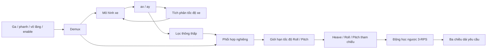
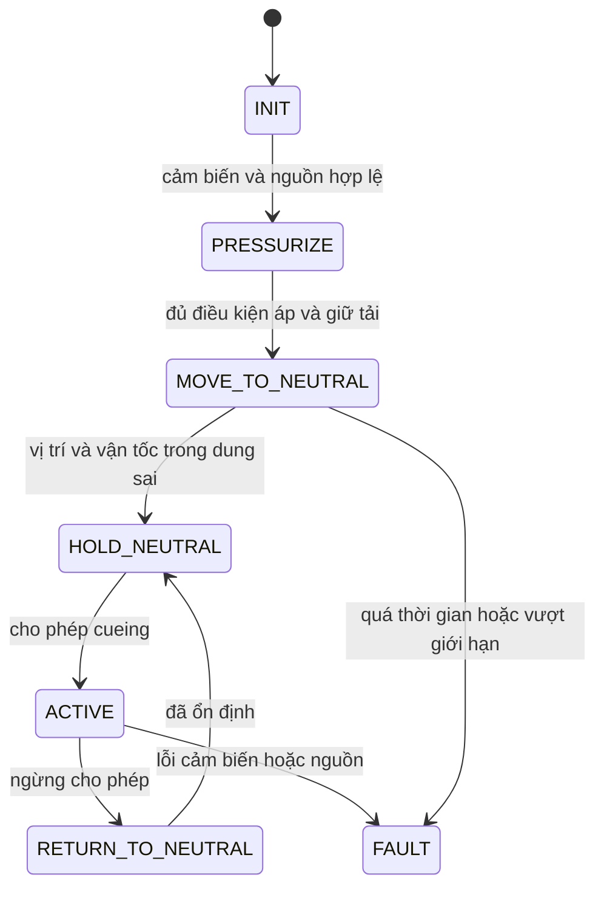

# Hướng dẫn MATLAB/Simulink cho ghế khí nén 3-RPS

Tài liệu tập trung vào **cách thao tác và nối khối**, kèm mô hình tham khảo để học từng bước. Đây là bộ hướng dẫn mới được dựng từ nội dung đã trao đổi và bộ MATLAB còn lưu trên GitHub; **không phải tệp ZIP cũ được khôi phục nguyên vẹn**.

**Phân biệt ngay từ đầu:**

| Ví dụ | Thực hiện gì? | Không được coi là gì? |
|---|---|---|
| `ghe3_ik_reference.mdl` | Quỹ đạo sinusoid 0,09 Hz → động học ngược → ba chiều dài yêu cầu | Không phải chuyển động thật hoặc đáp ứng khí nén |
| `ghe3_driver_reference.slx` do script tạo | Ga/phanh/lái → mô hình xe đơn giản → tư thế tham chiếu → chiều dài yêu cầu | Chưa có buồng khí, chuyển động thực hoặc điều khiển vòng kín |
| `ghe3_valve_logic_reference.slx` do script tạo | Vùng chết, hysteresis, trễ và thời gian giữ trạng thái van 5/3 | Phản hồi trong bài thử được lập sẵn, không phải cảm biến của ghế mô phỏng |

Chưa có MATLAB/Simulink trong môi trường biên soạn để xác nhận mở/compile các model. API được chọn hướng tới MATLAB R2017b. Đọc `VALIDATION.md` để biết các kiểm tra thực sự đã làm; không coi các ví dụ này là bộ điều khiển sẵn để đưa vào ghế có người ngồi.

## 1. Tải và đặt thư mục

Tải ZIP ở thư mục `downloads` của repository, giải nén vào thư mục riêng, ví dụ `D:\PBL2_Simulink`. Không chạy các file nằm trực tiếp trong cửa sổ ZIP của Windows.

Trong MATLAB:

1. Chọn thư mục đã giải nén ở ô **Current Folder**.
2. Bảo đảm nhìn thấy `ghe3_reference_init.m`, `build_ghe3_reference.m`, `ghe3_ik_reference.mdl` và thư mục `core`.
3. Trong **Command Window**, chạy:

```matlab
p = ghe3_reference_init();
```

Lệnh này thêm đường dẫn đến các hàm động học, tạo thông số và các tín hiệu mẫu. Trong **Workspace** phải có:

- `ghe3_reference_parameters`: thông số đề tài.
- `ghe3_driver`: bảng thời gian và tín hiệu bàn đạp/vô lăng.
- `ghe3_valve_test`: bảng tham chiếu và phép đo giả lập để thử logic van.

Các hàm dạng `ghe3_forces(q,qd,qdd,p)` không chạy bằng cách chỉ gõ tên hàm hoặc bấm Run mà không truyền đối số. Lỗi `Not enough input arguments` không có nghĩa công thức bị hỏng; nó cho biết thiếu dữ liệu đầu vào.

## 2. Thông số đang dùng

| Đại lượng | Giá trị | Ghi chú |
|---|---:|---|
| Bán kính tâm khớp dưới | 420 mm | Cạnh ngoài khung là 1000 mm, không phải cạnh nối tâm khớp |
| Bán kính tâm khớp trên | 360 mm | Giả thiết cần đo xác nhận |
| Xy lanh | SC63-500 | Piston 63 mm, cần 20 mm, hành trình 500 mm |
| Chiều dài thu hết | 731 mm | Giả thiết chiều dài tâm khớp cả gá và mắt trâu |
| Chiều dài trung tính | 981 mm | Piston ở 250 mm |
| Cao độ trung tính | 979,163418 mm | Tính từ hình học hai vòng khớp đồng hướng |
| Tải | Người 100 kg + ghế 20 kg | Khối lượng ghế còn giả thiết |
| Áp cấp sau điều áp | 3 bar dư | Áp bình khác áp cấp |
| Máy nén | PA-12L, bình 12 L | 40 L/phút ghi nhãn chưa xác nhận FAD |
| Quỹ đạo mẫu động học | ±20 mm, Roll/Pitch ±4°, 0,09 Hz | Không chứng minh giới hạn thiết kế 15° |

Khớp dưới là chốt CA nằm ngang, tiếp tuyến vòng bố trí khớp; thân xy lanh quay quanh chốt. Khớp trên là khớp cầu. Hàm `core/ghe3_geometry.m` giải cả chuyển động phụ x,y,yaw, không tự cố định cả ba bằng 0 khi nghiêng.

Mọi tính toán nội bộ dùng m, rad, s, Pa, kg. Đổi mm sang m và độ sang rad trước khi đưa vào các hàm.

[CHÈN THÔNG SỐ CATALOGUE TẠI ĐÂY: SC63-500 và gá lắp — kích thước tâm khớp, hành trình, áp suất, góc lệch khớp, ma sát]

## 3. Ví dụ nhanh nhất: mở file `.mdl`

Sau khi chạy khởi tạo, nhập:

```matlab
open_system('ghe3_ik_reference.mdl');
```

Trên thanh công cụ Simulink:

1. Nhấn **Ctrl+D** để Update Diagram.
2. Nếu chưa có lỗi đường dẫn, nhấn **Run**.
3. Nhấp đúp **RequiredLengths** để xem ba chiều dài chân.
4. Chọn autoscale trong Scope để dễ nhìn.

Ví dụ này có ba Sine Wave, một Mux, một hàm động học ngược, một Scope và một To Workspace. Thứ tự đầu vào Mux là **[h; Roll; Pitch]**. Tần số của Sine Wave nhập theo rad/s, vì vậy giá trị là `2*pi*0.09`, không phải `0.09`.

Roll có pha `pi/2` để khảo sát phối hợp roll–pitch. Tại đầu bài thử, Roll đã khác 0. Đây là benchmark động học, không có ramp khởi động và không dùng trực tiếp làm lệnh phần cứng.

Có thể xem kết quả bằng MATLAB:

```matlab
plot(ghe3_L_reference.time, ...
     1000*ghe3_L_reference.signals.values);
grid on;
xlabel('Thoi gian [s]'); ylabel('Chieu dai yeu cau [mm]');
legend('L1','L2','L3');
```

Nếu `.mdl` không mở được, ghi lại thông báo MATLAB. File ở định dạng văn bản cũ để làm ví dụ tham khảo, chưa được kiểm chứng bằng trình nạp Simulink tại đây. Hai ví dụ tạo `.slx` ở mục tiếp theo là một cách khác để dựng mô hình bằng API thư viện trên máy bạn.

## 4. Tạo hai model `.slx` trên máy bạn

Chạy:

```matlab
p = ghe3_reference_init();
build_ghe3_reference;
```

Script tạo và mở:

- `ghe3_driver_reference.slx`;
- `ghe3_valve_logic_reference.slx`.

Mở từng model, chọn **Simulation → Model Configuration Parameters**, xác nhận **Normal mode**, rồi Ctrl+D trước khi Run. Nếu thư viện báo không tìm thấy một block, mở **Library Browser** và đối chiếu tên khối trong script với phiên bản MATLAB đang dùng.

Script không ghi đè model đã có. Nếu muốn tạo lại, đóng model và đổi tên file cũ trước. Không xóa một model bạn đã chỉnh sửa mà chưa sao lưu.

Chỉ cần MATLAB và Simulink cho các ví dụ này. Không cần Stateflow, Simscape hay Control System Toolbox. Các hàm Interpreted MATLAB Fcn chạy ở chế độ mô phỏng, không phải mã sẵn sàng sinh xuống vi điều khiển.

## 5. Model ga–phanh–vô lăng: hiểu từng khối



### 5.1 Driver: From Workspace

Nhấp đúp khối **Driver**, kiểm tra:

- Variable name: `ghe3_driver`.
- Sample time: `0.01` s.
- Interpolate data: tắt để thử tín hiệu bậc.

Bảng dữ liệu có năm cột: thời gian, ga, phanh, góc vô lăng rad, enable. Lịch mẫu:

| Khoảng thời gian | Thao tác |
|---|---|
| 0–3 s | Enable=0, yêu cầu trung tính |
| 3–5 s | Cho phép cueing, chưa ga/phanh |
| 5–13 s | Ga=0,35 |
| 13–17 s | Phanh=0,12 |
| 17–21 s | Vô lăng +0,5 rad, đánh trái |
| 21–25 s | Vô lăng −0,5 rad, đánh phải |
| Sau 25 s | Enable=0, yêu cầu trở về trung tính |

Đây là tín hiệu mẫu được chọn để học. Không đại diện một xe hoặc cảm giác lái đã nhận dạng. Muốn đổi lịch, sửa các dòng tạo ma trận U trong `ghe3_reference_init.m`, chạy lại khởi tạo rồi Run model.

### 5.2 Vehicle: mô hình xe, không ánh xạ ga trực tiếp sang góc

Mux **VehicleMux** nhận [ga; phanh; góc vô lăng; tốc độ xe]. Khối Interpreted MATLAB Fcn gọi `ghe3_vehicle_accel(u)` và trả [ax;ay].

Theo cân bằng lực dọc của xe một khối lượng, gia tốc được mô hình hóa như sau (mô hình tự lựa chọn, chưa nhận dạng xe cụ thể):

$$a_x=\frac{F_{t,max}u_t-F_{b,max}u_b-c_dU^2-F_r\tanh(U/U_\epsilon)}{m_v}.$$

Trong đó: ax m/s²; lực kéo/phanh cực đại Ft,max, Fb,max và lực cản lăn Fr N; ga/phanh ut,ub không thứ nguyên; tốc độ U và ngưỡng trơn Uε m/s; hệ số cản cd N·s²/m²; khối lượng xe mv kg. Mã minh họa dùng 1400 kg, lực kéo 4000 N, lực phanh 8000 N; các giá trị này là của **xe giả lập**, khác tải ghế 120 kg.

Theo mô hình xe đạp động học, gia tốc ngang được suy ra từ tốc độ và góc bánh dẫn hướng:

$$a_y=\frac{U^2}{\ell}\tan(\delta),\qquad \delta=\delta_{sw}/i_s.$$

Trong đó: ay m/s²; chiều dài cơ sở ℓ m; góc bánh δ và vô lăng δsw rad; tỷ số lái is không thứ nguyên. Mã dùng ℓ=2,6 m, is=16, có giới hạn miền góc/gia tốc cho ví dụ; chưa có trượt lốp.

Đầu ra ax vào Integrator **Speed** để tính tốc độ U. Integrator giới hạn tốc độ từ 0 đến 60 m/s trong ví dụ, không mô phỏng số lùi. Khi lực kéo cân bằng lực cản, ax về 0 dù ga vẫn khác 0. Khi U=0, đánh lái không tự sinh ay.

Nếu lấy dữ liệu từ game, dùng ax,ay,az và tốc độ do game cung cấp, xác định hệ trục/đơn vị rồi thay khối Vehicle. Không cộng thêm một lần gia tốc suy từ bàn đạp vào telemetry có sẵn.

### 5.3 LP_ax và LP_ay: bộ lọc chậm

Nhấp đúp mỗi **Transfer Fcn**:

- Numerator: `[0.5]`.
- Denominator: `[1 0.5]`.

Theo bộ lọc thông thấp bậc nhất được chọn để minh họa, hàm truyền là:

$$H_{LP}(s)=\frac{\omega_c}{s+\omega_c},\qquad\omega_c=0.5\;\mathrm{rad/s}.$$

Trong đó: HLP không thứ nguyên; biến Laplace s và tần số góc ωc đơn vị s⁻¹. Giá trị này gây đáp ứng chậm; chưa phải chỉnh định cảm giác tối ưu. Không lấy tần số điện 50 Hz của máy nén làm tần số cắt cueing.

### 5.4 TiltReference: quy ước Pitch/Roll

Hệ trục: x về trước, y sang trái, z lên trên; quay dương theo quy tắc bàn tay phải. Với thứ tự quay cơ cấu đã dùng, Pitch âm ngả sau; Roll dương làm bên trái mặt ghế nâng lên, tức nghiêng về phải.

Khi khớp các thành phần gia tốc riêng ngang với trọng lực chiếu trong trường hợp gần thẳng hàng, góc phối hợp nghiêng được suy như sau (tự suy, không trích nguyên văn một thuật toán Washout):

$$\theta_r=-\arcsin(k_c a_{x,LP}/g),\qquad
\phi_r=\arcsin\!\left(\frac{k_c a_{y,LP}}{g\cos\theta_r}\right).$$

Trong đó: θr Pitch, φr Roll rad; ax,LP và ay,LP m/s²; hệ số giảm biên kc=0,5 không thứ nguyên; g m/s². Mã bảo vệ miền arcsin và co chung hai góc nếu vượt ±4°. Nếu yaw hoặc góc lớn, cần khớp véc tơ trong cùng hệ trục đầy đủ.

Tăng tốc ax dương → Pitch âm; phanh → Pitch dương. Cua trái tạo gia tốc riêng mục tiêu sang trái và cảm giác quán tính sang phải; không đồng nhất hai hướng này.

Enable=0 làm tư thế mục tiêu về trung tính. Enable là cho phép chuyển động, không phải chân ga; nhả ga vẫn có thể có giảm tốc do lực cản. Model chỉ đổi **tư thế tham chiếu**, chưa biết ghế thực có ở đó hay không.

### 5.5 Rate Limiter: làm chậm chuyển nghiêng

RollRate/PitchRate giới hạn tốc độ thay đổi góc:

- Rising slew limit: `2*pi/180` rad/s.
- Falling slew limit: `-2*pi/180` rad/s.

Đây là giá trị minh họa, không phải ngưỡng cảm giác người đã xác nhận. **Rate Limiter không bảo đảm giới hạn gia tốc góc hoặc jerk.** Muốn chuyển động trơn C2 có giới hạn jerk, cần thêm bộ sinh quỹ đạo S-curve/đa thức và kiểm tra hình học cả đoạn; ví dụ hiện tại chưa làm bước đó.

Các bộ lọc và giới hạn này có thể khiến góc ghế đổi dấu muộn khi chuyển từ ga sang phanh. Đừng coi trễ toàn chuỗi chỉ là trễ van 25 ms, hoặc gọi ví dụ là tái tạo cảm giác thật.

### 5.6 Heave

Model bàn đạp/vô lăng giữ heave bằng cao độ trung tính vì chưa có tín hiệu gia tốc đứng. Không tự thêm nâng hạ cho mọi thao tác ga/phanh.

Nếu có az đã loại trọng lực, có thể bổ sung kênh washout đứng sau khi xác minh trục và đơn vị. Việc tích phân tín hiệu nhiễu hai lần dễ gây trôi; cần thiết kế bộ lọc và đưa về trung tâm, không nối trực tiếp hai Integrator rồi coi là chuyển động đúng.

### 5.7 IK_3RPS: chiều dài yêu cầu

Khối gọi `ghe3_reference_ik(u)` với u=[h;Roll;Pitch], trả ba chiều dài tâm khớp **L**, đơn vị m.

Theo vòng kín hình học của cơ cấu, chiều dài chân và hành trình piston được tính như sau:

$$\mathbf D_i=\mathbf c+R\mathbf A_i-\mathbf B_i,\quad
L_i=\|\mathbf D_i\|,\quad s_i=L_i-L_{min},\quad\mathbf T_i^T\mathbf D_i=0.$$

Trong đó: Ai là tọa độ khớp trên trong hệ ghế, Bi là tọa độ khớp dưới trong hệ đế, c=[x,y,h]ᵀ, Di đều m; R là ma trận quay; Ti là véc tơ đơn vị dọc chốt CA; s là hành trình piston m. Ràng buộc cuối được dùng để giải x,y,yaw phụ trong `ghe3_geometry`.

Tại trung tính, ba L phải xấp xỉ 0,981 m, còn s là 0,250 m. Không đưa L=0,981 m vào một actuator có stroke tối đa 0,5 m mà quên trừ Lmin.

## 6. Xem kết quả trong Scope và Workspace

Model Driver có:

- **PoseScope**: h,Roll,Pitch tham chiếu; ba kênh có đơn vị khác nhau nên nên tách Scope khi trình bày báo cáo.
- **LengthScope**: L1,L2,L3 yêu cầu.
- `ghe3_q_reference`, `ghe3_L_reference`: các log để vẽ bằng MATLAB.

Để xem góc theo độ:

```matlab
q = ghe3_q_reference.signals.values;
t = ghe3_q_reference.time;
subplot(2,1,1);plot(t,180/pi*q(:,2:3));grid on;
ylabel('Goc [deg]');legend('Roll','Pitch');
subplot(2,1,2);plot(t,1000*(q(:,1)-p.h0));grid on;
ylabel('Heave [mm]');xlabel('t [s]');
```

Đường này là **tham chiếu**. Trong ví dụ chưa có L thực, lực thực, áp suất hai buồng hoặc sai số bám. Không lấy lại đường L yêu cầu rồi đổi tên thành L thực để vẽ hai đường trùng nhau.

## 7. Model riêng để hiểu van 5/3

Mở `ghe3_valve_logic_reference` sau khi chạy builder. Nguồn `ghe3_valve_test` gồm thời gian, ba độ dời yêu cầu và ba độ dời đo giả lập. Giá trị ở đây là độ dời quanh trung tính; cộng 250 mm nếu muốn biểu diễn hành trình tuyệt đối.

**Phép đo giả lập được lập sẵn, trễ 0,30 s so với lệnh, không do van tạo ra.** Nó chỉ giúp nhìn trạng thái van trong lúc đang sai số và khi hết sai số; không dùng bài này để tính đáp ứng hoặc lượng khí của ghế.

Khối `Valve_logic` xử lý:

| Kết quả | Ý nghĩa |
|---|---|
| +1 | Yêu cầu cấp buồng không cần, xả buồng có cần để đẩy ra |
| 0 | Yêu cầu van về trung tâm kín |
| −1 | Yêu cầu cấp buồng có cần, xả buồng không cần để thu về |

Vùng bật là ±1,5 mm; vùng tắt là ±0,5 mm. Giữa hai vùng, giữ trạng thái trước để tránh rung lệnh. Trễ đặt 25 ms, Ts=10 ms nên trễ hiệu dụng làm tròn lên 30 ms. Trạng thái trước phải giữ ít nhất 80 ms mới đổi được. Tất cả các giá trị là giả thiết minh họa.

Chạy model rồi mở Scope **ValveStates**. Đầu bài thử có sai số bằng 0 nên ba van ở 0. Khi xuất hiện sai số dương/âm, quan sát van chưa đổi ngay; khi phép đo giả lập bắt kịp, van trở lại 0 sau điều kiện trễ/dwell.

Đây là **điều khiển vị trí đơn giản**; chưa dùng vận tốc hoặc vòng lực. Với khí nén thật, chỉ relay sai số có thể gây dao động, stick-slip và đóng muộn. Cần phản hồi vận tốc/áp suất và tuning phù hợp khi phát triển tiếp.

[CHÈN THÔNG SỐ CATALOGUE TẠI ĐÂY: Van 5/3 trung tâm kín — sơ đồ cửa, điện áp cuộn, thời gian mở/đóng, tần suất chuyển, C/b hoặc lưu lượng theo chênh áp, rò rỉ]

## 8. Khởi động và giữ trung tính trong mô hình đầy đủ

Quản lý trạng thái cần có khi phát triển mô hình vật lý:



Sơ đồ trạng thái này là **hướng dẫn phát triển**, chưa được ghép thành một Stateflow chart trong hai model tham khảo.

- Van trung tâm kín không tự đưa piston về trung tính. Phải di chuyển tới trung tính và kiểm tra vận tốc trước khi đóng.
- Khởi động lạnh từ hai buồng chưa có áp khác khởi động lại khi đang giữ tải. Cần phương án đỡ/giữ tải trong thời gian nạp.
- Khi đóng kín, dòng khí cấp mới lý tưởng bằng 0 nhưng áp buồng vẫn phải cân bằng tải; áp thay đổi nếu piston còn di chuyển.
- Van trung tâm kín không phải khóa cơ khí chống tụt. Rò rỉ hoặc nén khí vẫn có thể làm ghế lệch.
- Khi lỗi, không tự xả hai buồng đang chịu người. Hành động lỗi phải được thiết kế theo hệ giữ tải thực, không chỉ dựa vào phần mềm.

## 9. Khi nào mới là mô hình khí nén vòng kín thật?

Để thay phép đo giả lập bằng chuyển động tính được, phải có:

1. Bình 12 L, máy nén bật/ngắt và điều áp.
2. Mạng dòng khí qua ba van, tiết lưu, ống, sáu buồng khí.
3. Phương trình áp suất theo khối lượng khí và thể tích biến thiên.
4. Lực piston từ hai áp suất, ma sát và tải.
5. Cơ cấu mặt ghế chung 3-RPS, không phải ba tải độc lập.
6. Cảm biến/ước lượng vị trí, tốc độ, Pitch/Roll và các áp suất cần thiết.

Theo bảo toàn khối lượng đẳng nhiệt của buồng khí lý tưởng, có thể xây mô hình toán học như sau:

$$V_A=V_{A0}+As_i,\quad V_B=V_{B0}+A_a(S-s_i),\quad
\dot p_A=\frac{R_aT\dot m_A-p_AA\dot s_i}{V_A},\quad
\dot p_B=\frac{R_aT\dot m_B+p_BA_a\dot s_i}{V_B}.$$

Trong đó: V,V0 m³; diện tích piston A và vành khuyên Aa m²; tổng hành trình S và hành trình si m; áp suất **tuyệt đối** p Pa; dòng khối lượng có dấu vào buồng kg/s; hằng số khí Ra J/(kg·K), nhiệt độ T K.

Theo cân bằng lực mặt piston, lực khí được tính từ hai áp suất như sau:

$$F_{gas,i}=A(p_{A,i}-p_{atm})-A_a(p_{B,i}-p_{atm}).$$

Trong đó: Fgas N, pA,pB,p_atm Pa, diện tích m². Sau đó xét ma sát và lực khác; không vừa nhân một hiệu suất tổng chưa nhận dạng vừa trừ trùng tổn thất ma sát.

Theo công ảo và Newton–Euler cho cùng một mặt ghế, chuyển động phải thỏa hệ liên kết:

$$M(\mathbf q)\ddot{\mathbf q}+\mathbf b(\mathbf q,\dot{\mathbf q})=J(\mathbf q)^T\mathbf F.$$

Trong đó q=[h;Roll;Pitch], J ánh xạ đạo hàm tư thế sang vận tốc chân; F là ba lực dọc N; M là ma trận khối lượng suy rộng, b gồm trọng lực/quán tính/ngoại lực. Đơn vị suy rộng theo h là N, theo góc là N·m. Không gán mọi phần tử M cùng đơn vị kg.

Nếu dùng Simscape Multibody, có thể dựng ba chuỗi Revolute–Prismatic–Spherical cùng nối tới một mặt ghế có khối lượng/COM/quán tính. Tác động lực vào khớp tịnh tiến, đo chiều dài, không đồng thời áp đặt cả hành trình và lực để rồi gọi là giải chuyển động tự do.

Thư viện khí Gas/Pneumatic và các block hậu tố (G) thay đổi theo phiên bản. Chưa xác nhận mọi block của phiên bản hiện hành có trong R2017b. Nếu thiếu, dùng mô hình phương trình phù hợp; không dùng mô hình dầu thủy lực rồi coi là khí nén tương đương.

Theo cân bằng khí trong bình đẳng nhiệt, nguồn khí phải được kiểm tra bằng dòng khối lượng:

$$\dot p_T=\frac{R_aT}{V_T}\left(\dot m_C-\sum_i\dot m_{supply,i}\right).$$

Trong đó: áp bình tuyệt đối pT Pa, thể tích VT m³, các dòng kg/s; Ra và T như trên. Áp bình giả thiết 6–8 bar dư khác áp đặt sau điều áp 3 bar dư. Lưu lượng 40 L/phút trên nhãn chưa được coi là FAD đo tại áp làm việc. Các model tham khảo hiện **chưa giải** phương trình này, không dùng chúng để kết luận máy nén đủ.

[CHÈN THÔNG SỐ CATALOGUE TẠI ĐÂY: PA-12L và bộ lọc–điều áp — FAD theo áp, duty/nhiệt, ngưỡng rơ-le, lưu lượng và sụt áp]

[CHÈN THÔNG SỐ CATALOGUE TẠI ĐÂY: Tiết lưu, ống, đầu nối và giảm thanh — kích thước trong, chiều dài, đặc tính Q–p, áp–nhiệt; bố trí meter-out đúng chiều]

## 10. Kiểm tra trước khi đưa tín hiệu ra vi điều khiển

Bắt đầu bằng mô phỏng không phần cứng. Vô lăng/bàn đạp có thể gửi dữ liệu qua USB/Serial hoặc giao thức phù hợp MCU; chưa mặc định máy tính mô phỏng chạy thời gian thực.

Một MCU trung tâm đọc ba cảm biến hành trình và điều khiển sáu ngõ cuộn van giúp đồng bộ đơn giản hơn ba MCU độc lập. Nếu dùng nhiều MCU cần thời gian chung, giám sát tuổi bản tin và trạng thái lỗi. IMU đo Roll/Pitch không tự thay thế phép đo hành trình/heave.

Cuộn van phải có driver công suất theo điện áp/dòng thực, bảo vệ và liên động; không nối trực tiếp vào GPIO. Nếu dùng van tỷ lệ/điều áp điện–khí, phải bổ sung đúng phần cứng và phản hồi. Van 5/3 đóng/ngắt không trở thành van tỷ lệ chỉ nhờ đổi thuật toán; bộ điều áp chung không điều khiển độc lập ba lực.

**Trước mắt, hãy hoàn thành ba việc trên Simulink:**

1. Thấy đúng dấu Pitch/Roll khi ga, phanh, cua.
2. Thấy ba chiều dài yêu cầu đúng hình học và đơn vị.
3. Thấy van về 0 khi sai số nằm trong vùng chết, với trễ/hysteresis/dwell đúng.

Sau đó mới xây plant khí nén liên kết và đánh giá sai số bám, lực, lưu lượng, áp suất. Không lấy đồ thị đẹp của quỹ đạo yêu cầu làm bằng chứng ghế thực đã đạt.

## 11. Các lỗi thường gặp

| Lỗi/hiện tượng | Cách kiểm tra |
|---|---|
| `Undefined function ghe3_geometry` | Chạy `ghe3_reference_init`; kiểm thư mục core và Current Folder |
| Không có `ghe3_driver` | Chạy lại khởi tạo sau khi mở MATLAB mới |
| Không tìm thấy block khi builder chạy | Kiểm phiên bản/library; chưa xác nhận compile R2017b tại đây |
| `Not enough input arguments` | Không chạy riêng hàm cần q,qd,qdd,p mà không có đối số |
| Góc lớn gấp 57 lần | Nhầm độ với rad |
| Hành trình vượt 500 mm | Có thể đang dùng chiều dài L thay vì stroke L−Lmin |
| Scope chỉ thấy h gần 1, góc gần 0 | Khác đơn vị; tách Scope hoặc đổi m→mm, rad→độ |
| Đánh lái khi đứng yên mà ghế không nghiêng | Đúng với mô hình xe đạp; ay phụ thuộc U² |
| Đổi tham số nhưng đồ thị không đổi | Khởi tạo lại biến Base Workspace, kiểm tên model đang Run |
| L yêu cầu và L thực giống hệt | Kiểm tra có nối nhầm cùng một tín hiệu; model động học hiện chưa có L thực |

Tài liệu không tự tạo trích dẫn hay số trang. Các công thức được nêu là mô hình nền/tự suy để hướng dẫn; thông số hình học kế thừa bộ mã trong `core`, chưa coi catalogue còn thiếu là đã được xác nhận.
