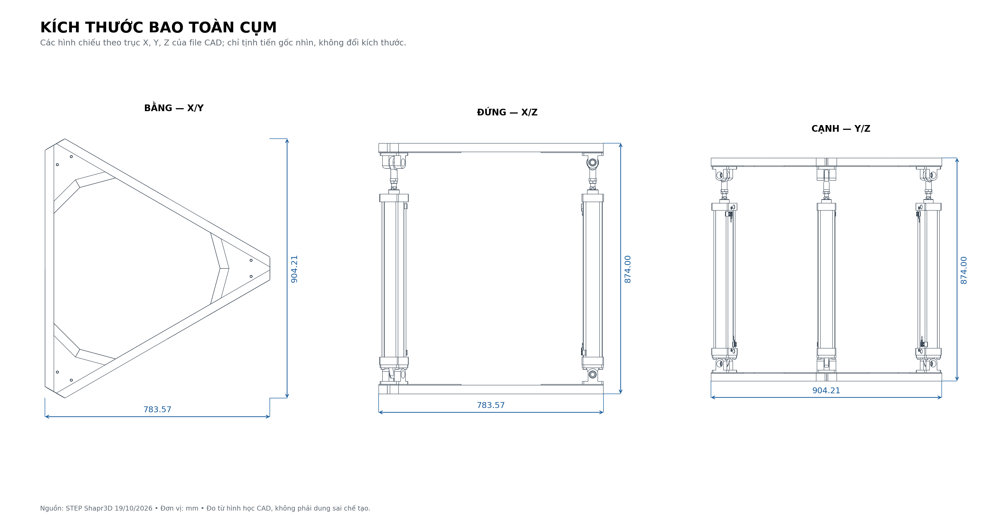
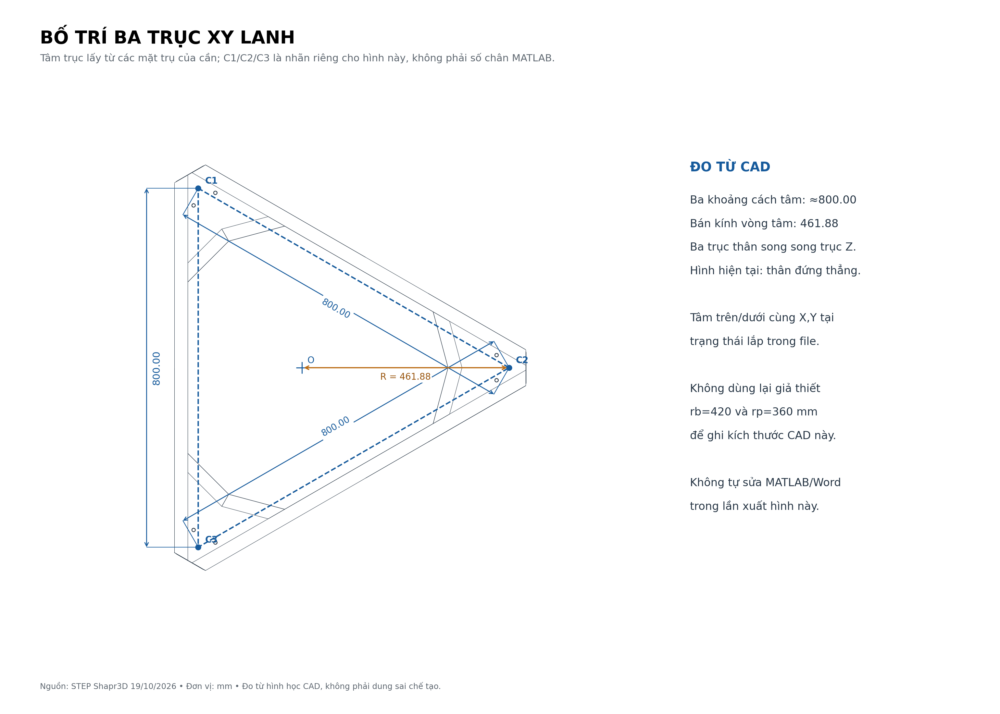
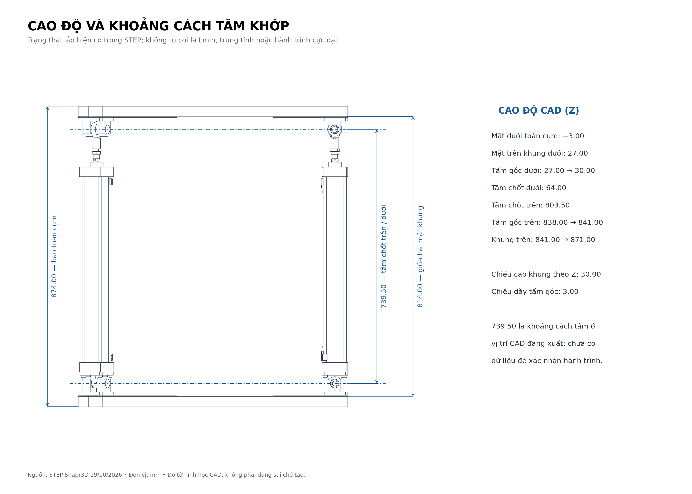
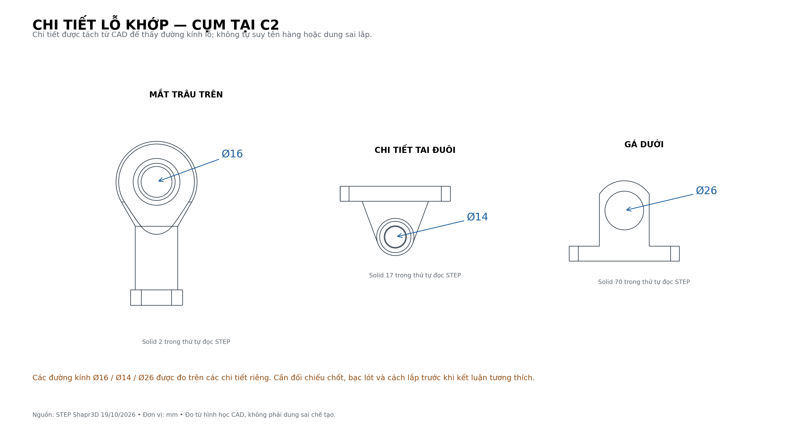
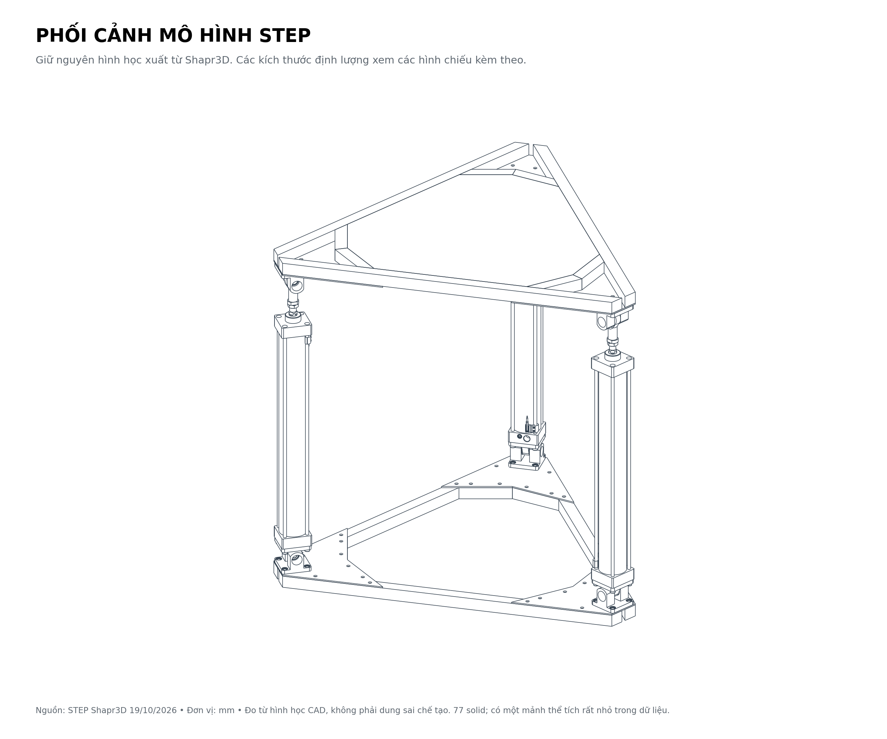

# Minh họa kích thước từ STEP Shapr3D 19/10/2026

Đơn vị mm. Đo trực tiếp từ hình học CAD, không phải bản vẽ dung sai chế tạo.

- [Tải toàn bộ ảnh PNG, SVG và PDF](../../downloads/Kich_thuoc_STEP_2026_10_19.zip).
- [Bộ hình PDF 5 trang](Bo_hinh_kich_thuoc_CAD.pdf).

Kích thước bao X×Y×Z: **783,57 × 904,21 × 874,00 mm**. Tam giác tâm trục xy lanh cạnh khoảng **800 mm**, bán kính vòng tâm **461,88 mm**. Các thân đang đứng thẳng. Khoảng cách tâm chốt trên–dưới **739,50 mm** là vị trí CAD hiện tại, chưa xác nhận là Lmin hoặc trung tính.

Bố trí này khác giả thiết MATLAB 420/360 mm trước đây. Chưa sửa mã MATLAB, báo cáo hoặc prompt. Các đường kính lỗ khớp đo trên chi tiết riêng chưa chứng minh lắp ghép đạt.

